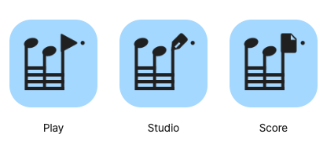

# 띠로리 음형 앱 아이콘 · 후보 03

2026-10-24 · **A 「마지막 음이 하는 일」 추천**, 사용자 승인 대기. [최신 비교 화면](index.html) · [검증 기록](verification.md) · [공식 레퍼런스](references.md)

띠로리의 세 음이 먼저 보이고, 마지막 음에서 앱의 기능이 읽히도록 구성했다. 기존 기능 도형에 작은 음표를 덧붙이지 않았다. 이번 범위는 후보 제작이며 실제 런처·제품 UI·배포 메타데이터·공통 토큰은 변경하지 않았다.

## 기준 원본과 이력

- 사용자 지정 음가: **64분 / 64분 / 점32분**. 높음–낮음–높음.
- [연구 원본 round-4](../../ddirori-visuals/round-4/motif.svg)와 [제작용 음형](../assets/motif.svg)의 좌표·연결 구조가 같음을 확인했다. 차이는 잉크색이다. 초기 PNG 보드의 부정확한 빔을 기준으로 삼지 않았다.
- [승인된 바흐](../assets/bach-surprised.svg)는 보조 캐릭터로 유지한다. 이번 아이콘에는 넣지 않는다.
- [기존 운영 자산](../assets/)과 [직전 v2 후보·검증 기준](../icon-family-v2/)는 전부 보존했다.
- 기존 문서의 “기능 실루엣으로 구분”은 당시의 적용 상태다. 이번 요청에 따라 새 **후보 방향**은 “음형과 기능의 통합”으로 갱신했다. 기존 설치 아이콘까지 바뀐 것으로 기록하지 않는다.
- 색 원본은 [현행 팔레트](../../ddirori-design-system/palette-candidates.json)다. 바이올렛도 블루도 최종 승인색이 아니다. 제품의 임시 라임값은 유지했다.

## 두 방향의 비교

| 항목 | A · 마지막 음이 하는 일 | B · 기둥에서 이어지는 기능 |
| --- | --- | --- |
| 결합 | 세 번째 머리가 기능 심벌, 기둥·빔이 음형 | 타원형 세 머리를 유지하고 오른쪽 기둥을 기능 윤곽으로 확장 |
| Play | 마지막 머리가 재생 삼각형 | 마지막 기둥과 세 빔의 끝이 재생 윤곽의 왼쪽 경계를 공유 |
| Studio | 마지막 머리가 펜촉, 기둥이 펜 자루 | 마지막 기둥을 두꺼운 펜 몸체와 아래쪽 펜촉으로 연장 |
| Score | 마지막 머리가 접힌 악보 페이지 | 마지막 기둥이 악보 페이지의 왼쪽 가장자리 |
| 음악 인상 | 세 음의 움직임과 네 빔이 먼저 보임 | 원래 음표 머리를 더 충실히 보존 |
| 기능 식별 | 머리 세 형태가 서로 다름 | 외곽 차이는 크지만 빔과 기능 윤곽이 몰림 |
| 약점 | 표준 기보와 다른 머리. 작은 크기에선 펜·파일 차이가 줄어듦 | 아래쪽이 무겁고, 펜은 화살표·페이지는 가방으로 읽힐 여지 |
| 판단 | **추천. 기능 결합에 필요한 선을 적게 추가함** | 원본 머리 보존을 우선할 때의 대안 |

위 평가는 제작자의 시각 판단이다. 사용자 식별률을 측정한 결과가 아니다. A의 Score는 페이지 자체만 보면 일반 파일이지만, 나머지 음형과 결합해 음악 문서의 맥락을 얻는다. A의 Studio는 작은 크기에서 USB나 표시 깃발로 읽힐 가능성을 사용자 검증 항목으로 남긴다.

## 유지한 것과 변형한 것

256×256 기준 원본 좌표:

| 요소 | 원본 및 유지 규칙 |
| --- | --- |
| 머리 중심 | (63,68), (116,92), (169,68). 첫 두 머리의 타원·회전은 그대로 유지 |
| 기둥 | x49, x102, x155. 최하단 빔 y206까지 연결 |
| 긴 빔 | y156,176,196 / x49부터159.5 / 높이10 |
| 짧은 네 번째 빔 | **맨 위 y136**, 첫 두 기둥 사이 x49부터106.5 |
| 점 | 마지막 높은 머리 옆 y68. B x206/r6, A는 커진 머리와 겹치지 않게 x213/r6 |

A의 마지막 머리는 표준 타원형 대신 기능 윤곽으로 변형했다. 마지막 음이 높은 위치라는 관계와 4·4·3 빔 연결, 점은 유지한다. **음악적으로 정확한 모브랜드 마스터는 기존 원본이며, A는 그 구조를 바탕으로 한 브랜드 변형이다. 악보에 입력하는 표준 음표 글리프로 사용하지 않는다.** 기능 형태를 음표로 치환하는 만큼 표준 기보 외형까지 그대로라고 주장하지 않는다.

Play는 머리 왼쪽 경계를 x149로 두어 기둥 상단을 덮는다. Studio는 펜촉 내부 y78에서 기둥을 시작하고 접합부만 좁혔다. 아래쪽 기둥 중심은 x155다. Score는 페이지 안에 기둥 상단을 넣었다. 세 기둥의 상단이 머리 밖으로 노출되지 않는지 별도 머리 래스터와 비교 검사한다.

소형은 16·24px 출력용 별도 원본이다. 기둥9→11, 빔10→9, 점 반지름6→8로 조정한다. 머리 높낮이·네 빔·점을 생략하지 않는다. Studio 상단은 접합에 맞춘 예외다. 32px 이상은 기본형을 사용한다.

- **16px:** 축소 스트레스 비교용. 기능과 정확한 음가 판독을 보장하지 않음.
- **24·32px:** 목록에서 이름을 함께 사용. 기능 구분은 32px 이상을 잠정 제작 기준으로 삼음.
- **48px 이상:** 네 빔과 점을 따로 비교하기 위한 권장 크기. 실기기·사용자 검증으로 조정 가능.
- 원본과 기능 변형을 모두 놓고 읽어야 한다. 픽셀상 빔 네 개가 있다는 검사는 사람이 음가를 읽는다는 증명이 아니다.

## 색과 조형

| 비교색 | 배경 | 심벌 |
| --- | --- | --- |
| 블루 | #A5D8FF | #202020 |
| 바이올렛 | #D0BFFF | #202020 |
| 틸 | #96F2D7 | #202020 |

우선은 **세 앱 공통 블루**를 추천한다. 밝은 면 위 검은 음형의 대비를 확보하고, 기존 바흐의 흰 가발·살구 얼굴과 함께 두었을 때 색을 과하게 늘리지 않는다는 제작 판단이다. 파랑 자체에 음악이라는 뜻이 있다고 설명하지 않는다.

앱별 색 구분은 Play 블루 / Studio 바이올렛 / Score 틸로 비교한다. 이미 형태 차이가 있으므로 색으로만 앱을 구분하지 않는다. UI 주요 행동색·상태색·악보 지면은 별도 토큰 계약을 따른다. 대표색 확정은 이번 작업의 완료 조건이 아니다.

## 소스와 export

**편집 원본:** [family.json](family.json)의 directions → paths / smallPaths. 각 path에 head·stem·beam·dot·function 역할을 붙였다. SVG는 이 원본에서 생성한다. 정밀 수정 시 JSON과 재생성 결과를 함께 검토하고 생성 SVG만 수정하지 않는다.

- `generated/masters/{a,b}/{play,studio,score}-{regular,small}.svg`: 역할별 편집 가능한 벡터.
- `generated/icons/{a,b}/{mono,blue,violet,teal}/`: 배경 포함 SVG.
- `generated/png/`: 16·24·32·48·64·128·256·1024px.
- `generated/adaptive/`: 두 방향의 108dp 비교용 전경. Studio도 비교 가능하나 Android 출시 대상이라는 뜻은 아님.
- `generated/platform/{blue,violet,teal}/{play,score}/`: 추천 A의 현행 iOS Contents.json 규격, Google Play 512px, Android 밀도별 PNG·vector·adaptive XML.
- `generated/platform/{색}/studio/desktop/`: PNG, PNG 프레임 ICO·ICNS, Linux 크기별 파일.
- `generated/platform/{색}/{앱}/layers/`: Apple용 미마스킹 전경·배경 SVG. **Icon Composer로 컴파일한 .icon은 아님.**

iOS 크기는 실제 두 앱의 AppIcon.appiconset/Contents.json을 읽는다. 작은 iOS 출력에도 소형 보정을 적용한다. Android는 108 좌표에서 scale .27 / translate19.44, 중심66dp 안전 원에 모든 핵심 픽셀이 들어가는지 검사한다. 스토어와 Android adaptive 규격을 혼동하지 않는다. Electron 패키징 경로는 변경하지 않았다.

모든 출력은 **candidate**다. 기존 앱 리소스에 복사하거나 스토어에 제출하지 않았다. 생성된 490개 파일의 해시와 소스 해시는 [manifest](generated/manifest.json)에 기록한다. PNG 375개는 대안·색·크기 비교와 플랫폼 export를 합한 수다.

## 다음 사용자 확인

1. 마지막 머리가 바뀌어도 띠로리 음형으로 느껴지는가? 원래 타원 머리를 지키는 B가 더 중요한가?
2. 이름을 가렸을 때 세 아이콘을 재생·편집·악보 열람으로 연결할 수 있는가? 특히 Studio와 Score를 구분할 수 있는가?
3. 공통 블루와 앱별 세 색 중 어떤 쪽이 하나의 브랜드처럼 느껴지는가?
4. 홈 화면에서 이 정도 빔 밀도가 적절한가? 24px 목록에는 이름을 함께 쓰는 정책이 괜찮은가?

사용자 승인 후 실제 기기·홈 화면·테마 아이콘·Dock·스토어 크롭을 확인하고, 별도의 제품 적용 작업에서 런처와 메타데이터를 갱신한다.
