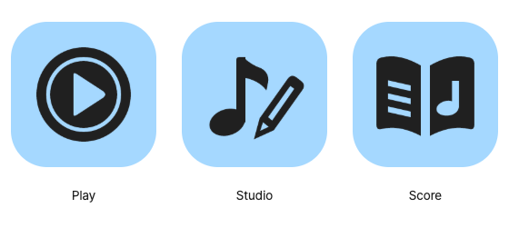

# 앱 아이콘 후보 04 · 기능을 먼저

2026-10-24 · [최신 비교 화면](index.html). 사용자 요청에 따라 음형의 반복보다 **앱의 용도 구분**을 우선했다. 음형을 아이콘의 필수 구성 요소로 두지 않는다.



| 앱 | 표현 | 이전 안에서 바뀐 점 |
| --- | --- | --- |
| Play | 음반을 연상시키는 원형·홈과 큰 재생 삼각형 | 작은 마지막 머리 대신 재생 동작을 중심에 둠 |
| Studio | 큰 음표와 사선 연필 | 펜촉만 변형한 머리 대신 쓰기 도구 전체를 보여줌 |
| Score | 펼친 악보와 페이지 속 음표 | 작은 파일 머리 대신 읽을 문서의 형태를 중심에 둠 |

같은 블루 배경, 짙은 단색 심벌, 비슷한 여백과 부드러운 마무리를 공유한다. 음악의 맥락은 각 기능에 필요한 정도로 넣었다. 모브랜드 음형과 바흐는 기존 원본을 보존하며 워드마크·브랜드 서명·반응 그래픽에서 사용할 수 있다. 기능 아이콘을 표준 기보 글리프로 쓰지 않는다.

## 판단과 남은 확인

이전 안은 세 아이콘의 대부분이 같고 마지막 머리의 작은 차이만 있었다. 이번 안은 원형 / 음표와 사선 / 펼친 페이지로 전체 윤곽이 달라진다. 직접 축소 비교에서 이전보다 구분하기 쉽다고 판단했다. 실제 사용자 식별률을 측정한 것은 아니다.

- Play는 재생 용도가 명확한 대신 일반 미디어 플레이어로도 읽힐 수 있다. 원형의 홈이 음악 음반의 보조 단서다.
- Studio는 음악 편집·만들기를 표현하지만 전문 사보 앱이라는 세부 의미까지 아이콘만으로 보장하지 않는다.
- Score는 음악 문서 읽기를 표현한다. Studio와 달리 펜을 넣지 않아 편집보다 열람에 무게를 둔다.
- 익숙한 기능 도형을 사용한 만큼 고유성은 이전보다 약할 수 있다. 이름·색·전체 브랜드 체계가 함께 보완한다.
- 16·24px 소형은 음반 홈·연필 내부 선을 덜고, 악보 페이지의 줄 수를 줄였다. 작은 목록은 앱 이름을 함께 표시한다.
- 현재 블루는 형태 비교용이다. 대표색을 확정하거나 제품의 라임 임시 토큰을 변경하지 않았다.

사용자 확인의 우선순위는 **이름을 가려도 재생 / 음악 편집 / 악보 열람으로 구분되는가**다. 기능이 읽힌 뒤에 색과 고유한 비례를 더 다듬는다.

## 자산과 재현

[family.json](family.json)이 편집 원본이다. 역할별 path를 조정하고 재생성한다. 이전 v2·v3 자산과 검증 기록을 덮어쓰지 않았다.

- `generated/masters/a/`: 기본·소형 SVG.
- `generated/icons/a/`, `generated/png/a/`: 단색·블루·바이올렛·틸 및 16–1024px.
- `generated/platform/`: Play·Score iOS/Android 후보, Studio PNG·ICO·ICNS 후보, 전경·배경 SVG 레이어.
- `generated/adaptive/`: 108dp 비교용 전경. 실제 적용·컴파일을 의미하지 않는다.
- [manifest](generated/manifest.json): 생성 파일과 소스 해시.
- [직전 음형 중심 후보](../icon-family-v3/README.md): 이력 보존.

```sh
node docs/brand/ddirori-brand-system/icon-family-v4/tools/build.mjs
node docs/brand/ddirori-brand-system/icon-family-v4/tools/verify.mjs
node docs/brand/ddirori-brand-system/icon-family-v4/tools/verify-review.mjs
```

기존 독립 도구 `/tmp/ddirori-brand-tools`의 Resvg·Pillow·Playwright를 재사용한다. `DDIRORI_BRAND_TOOLS`, `DDIRORI_PYTHON`, `DDIRORI_BROWSER_PATH`, `DDIRORI_ICON_REVIEW_URL`로 경로를 바꿀 수 있다. 서버는 저장소 루트에서 `python3 -m http.server 8076 --bind 127.0.0.1`로 실행한다. 기존 서버가 있어 재사용했다. `build.mjs --out <빈 폴더>`로 독립 재생성이 가능하다.

## 검증과 범위

[자산 검사](evidence/verification.json) · [브라우저 검사](evidence/browser.json)

생성 파일 해시·독립 재생성, SVG 구조, PNG 규격·투명도·sRGB, ICNS/ICO 프레임 디코드, 마스터 경계와 adaptive 안전 원을 검사한다. 기능 중심 도형에는 이전 64·64·점32 음형의 빔 개수 검사를 적용하지 않는다.

브라우저에서는 4팔레트 × 3마스크 × 6크기의 72조합, 이름 숨김과 접근성 이름, 390px/200% 글자 확대의 넘침, 리소스 오류를 검사했다. [크기 비교](evidence/sizes.png), [이름 없는 흑백](evidence/comparison-blind-gray.png), [모바일](evidence/review-mobile.png)을 저장했다. assistant가 원본과 실제 축소 미리보기를 검토했다. 사용자 승인과 구분한다.

플랫폼 규칙은 직전 작업에서 확인한 [공식 레퍼런스](../icon-family-v3/references.md)와 제작 도구를 재사용했다. 이번에는 추가 시장 리서치를 수행하지 않았다. 새 형태를 카카오의 규칙이라고 설명하지 않는다.

이 작업은 후보 제작이다. 제품 코드·설치 런처·배포 메타데이터는 그대로이며 커밋·푸시·배포하지 않았다. 실기기 설치, 플랫폼 리소스 컴파일, 사용자 식별 테스트는 미실시다. 기존에 변경되어 있던 파일은 시작 시점 해시로 보존을 확인한다.
