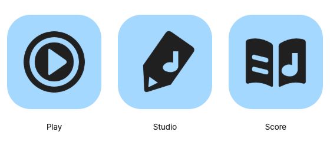

# 앱 아이콘 후보 05 · 기능과 공통 조형

2026-10-24 · **A 「연필 안의 음악」 + 공통 블루 추천**, 사용자 승인 대기.

[최신 리뷰 화면](index.html) · [조형 규칙](construction.md) · [레퍼런스](references.md) · [검증](verification.md)

음반·사선 연필·펼친 악보를 각각 큰 면으로 그리고, 그 안의 넓은 여백으로 기능을 표현한다. 기존 아이콘에서 유효한 Play의 원형·Score의 두 페이지는 유지했다. Studio를 음표+연필 두 물체에서 **음표가 파인 하나의 연필**로 바꿨다.

음형·음표·바흐의 필수 사용 규칙은 없다. 이번 후보에는 64·64·점32 모브랜드 음형을 사용하지 않았으며 승인된 음형·바흐 자산은 보존한다. 새로운 제품 UI 컴포넌트나 런처를 적용하는 작업은 아니다.

## 탐색과 선택

두 Studio 조형을 같은 Play·Score 옆에서 단색·블루·축소로 비교했다. Play·Score가 같은 두 줄은 의도된 비교 조건이며 서로 다른 완성 제품군 두 개를 억지로 만들지 않았다.

| 기준 | A · 연필 안의 음악 | B · 연필이 된 음표 |
| --- | --- | --- |
| 결합 방식 | 연필 외곽 안에 음표 여백 | 음표의 기둥을 연필로 변형 |
| 먼저 보이는 의미 | 쓰기·편집 | 음악 |
| 다른 앱과의 관계 | 큰 면과 내부 여백을 공유 | 검은 선 중심으로 상대적으로 가늘고 아래쪽에 무게가 몰림 |
| 남는 오해 | 마커·태그로 볼 가능성, 전용 사보 기능까지는 설명하지 못함 | 재생 앱·상향 화살표로 볼 가능성 |
| 선택 | **추천** | 탐색 기록으로 유지 |

A의 초기 스케치에서는 내부 음표도 연필과 함께 회전했으나, 최종 후보는 내부 음표를 수직으로 두었다. Score와 같은 방향으로 음악 기호를 읽을 수 있도록 한 제작 판단이다. 사용자 인지 테스트로 확인된 결과는 아니다.

## 이전 후보와의 차이

- Play: 홈 너비7→14. 잔선을 줄이고 중심 재생 여백과 큰 면을 강조.
- Studio: 별도 음표·연필 병렬 배치 제거. 사선 연필의 외곽과 내부 음악 여백으로 역할 통합.
- Score: 줄3→2, 끝을 둥글게, 내부 음표 기둥12→16. 넓은 면의 무게를 줄이기 위해 전체.96배 보정.
- 공통: 256 좌표계, 40–216 작업 범위, 약14–18 주요 틈, 부드러운 끝처리, 단색 면, 크기별 보정.

면적은 동일하게 맞추지 않았다. [측정과 시각 보정](construction.md)을 함께 기록했다. 실제 16px에서는 음악·쓰기의 세부 의미를 읽기 어렵고 이름 병기가 필요하다.

## 색상 판단

비교 화면에서 공통 블루와 Play 블루 / Studio 바이올렛 / Score 틸을 나란히 본다. **공통 블루를 우선 추천**한다. 각 외곽이 이미 달라 초기 제품군은 색의 반복으로 연결감을 주는 편이 적합하다는 판단이다. 앱별 색은 비교안으로 유지한다.

색은 기존 [팔레트 원본](../../ddirori-design-system/palette-candidates.json)에서 읽는다. 블루 #A5D8FF, 바이올렛 #D0BFFF, 틸 #96F2D7, 잉크 #202020. 대표색은 확정하지 않았으며 제품의 임시 라임 토큰을 바꾸지 않았다.

## 원본과 후보 파일

- [family.json](family.json): 역할별 편집 path, 기본/소형, 광학 보정 설명.
- `generated/masters/{a,b}/`: 기본·소형 SVG.
- `generated/icons/`, `generated/png/`: 단색·3색의 16–1024px.
- `generated/construction/`: 공통 작업 범위와 실제 형태를 보여주는 진단 그림.
- `generated/adaptive/`: 두 탐색안의 108dp 비교용 전경.
- `generated/platform/`: 추천 A의 Play·Score iOS/Android 및 Studio PNG·ICO·ICNS 후보, Apple 입력용 미마스킹 전경·배경 SVG.
- [manifest](generated/manifest.json): 493개 제작 파일과 소스 해시. PNG는375개.

출력용3색 파일은 기존 export 도구를 재사용한 결과이며 모두 실제 출시 색으로 승인했다는 뜻이 아니다. 플랫폼 규격은 현행 프로젝트 설정을 읽는다. .icon 컴파일이나 설치 검증을 수행한 것으로 취급하지 않는다.

[이전 기능 중심 후보](../icon-family-v4/README.md), [이전 음형 중심 후보](../icon-family-v3/README.md), v2의 자산·검증 기준은 수정하지 않았다. 최신 링크를 안내하는 상위 문서 세 곳만 갱신했다.

## 다음 사용자 확인

가장 먼저 확인할 질문은 **“Studio가 음악을 쓰는 앱으로 읽히면서 Play·Score와 같은 제품군처럼 느껴지는가?”**다.

그 다음 이름을 가린32·48·64px에서 재생·편집·악보 열람을 구분하는지 확인한다. 공통 블루와 앱별 색 중 어느 쪽이 적합한지 선택하고, 최종 승인 후 별도 작업에서 실기기 설치·런처·스토어 캡처·메타데이터를 갱신한다.
