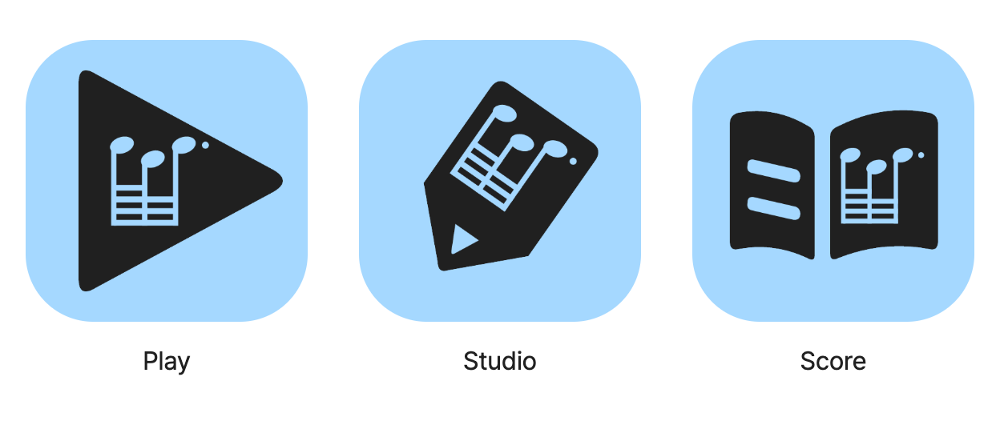

# 후보 06 · 기능 안의 띠로리 음형

2026-10-24. 사용자의 요청에 따라 후보 05의 기능별 외곽 안에 원본 띠로리 음형을 넣었다. 검토 후보이며 승인·제품 적용·대표색 확정을 의미하지 않는다.



[비교 화면](index.html) · [편집 원본](family.json) · [파일 목록](generated/manifest.json) · [이전 후보 05](../icon-family-v5/README.md)

## 바뀐 점

- **Play:** 원형 음반을 제거하고 재생 삼각형을 확대했다. 삼각형 안에 음형을 파냈다.
- **Studio:** 연필 몸통 폭을 92에서 116으로 넓혀 음형을 담았다. 음형도 연필과 함께 35° 회전한다. 연필 끝의 삼각형 여백은 유지한다.
- **Score:** 오른쪽 페이지를 넓혀 음형을 담고, 왼쪽은 읽기를 암시하는 두 줄을 유지한다.

큰 면과 둥근 끝처리, 같은 음형의 내부 여백, 기존 공통 블루(#A5D8FF)·잉크(#202020)로 연결한다. 외곽은 삼각형·사선 연필·펼친 악보로 구분한다. 블루는 기존 팔레트 원본을 읽으며 UI 토큰은 바꾸지 않았다.

## 음형 보존

[원본 motif.svg](../assets/motif.svg)의 전체 음형 그룹을 그대로 임베드했다. 개별 음표 머리·기둥·빔을 다시 그리지 않고 비례 확대·축소 및 회전만 적용했다. **64·64·점32**, 위쪽 짧은 빔, 아래쪽 세 빔, 마지막 기둥과 점이 유지된다.

투명 SVG는 내부 마스크로 음형을 실제 투명 여백으로 만든다. PNG는 해당 SVG를 렌더링한다. 내부 마스크는 자산 안에 포함되어 외부 의존성이 없다. 외부 이미지·폰트가 필요한 아이콘이 아니다. 향후 Android VectorDrawable 등으로 내보낼 때에는 마스크를 불리언 차집합 경로로 변환하고 별도 검증해야 한다. 이번 범위에는 플랫폼 패키징이 없다.

## 크기와 남은 판단

[실제 크기 비교](evidence/sizes.png). 16·24·32·48·64·128px와 256·512px를 생성했다. 작은 크기에서도 음가를 임의로 8분음표로 바꾸지 않았다. 대신 **16–32px에서는 빔·점이 명확하게 읽히지 않는다**는 한계를 남긴다. 이 크기에서는 이름을 병기하고 전체 실루엣으로 구분해야 한다. 최종 소형 전용 도안은 승인 후 별도 판단 대상이다.

Play는 원형 제거로 음반이라는 단서가 없어졌지만 내부 음형이 음악을 설명한다. Studio는 굵은 연필이 태그처럼 보일 가능성이 남는다. Score는 페이지 안 음형이 가장 작다. 이름 없는 식별 및 실제 홈 화면 검증이 필요하다. 이번 직접 시각 검토에서는 기능별 실루엣의 차이를 유지하면서 음형으로 묶이는 효과를 확인했다. 이는 사용자 테스트 결과가 아니다.

## 재생성·검증

저장소 루트에서:

```sh
node docs/brand/ddirori-brand-system/icon-family-v6/tools/build.mjs
/tmp/ddirori-brand-tools/venv/bin/python docs/brand/ddirori-brand-system/icon-family-v6/tools/verify.py
node docs/brand/ddirori-brand-system/icon-family-v6/tools/review.mjs
```

기존 임시 도구 설치의 Resvg·Playwright·Pillow를 재사용한다. `build.mjs --out <폴더>`로 별도 위치에 재생성할 수 있다. 리뷰 검증은 저장소 루트를 제공하는 localhost:8076 서버와 로컬 Chrome을 사용한다. 제품 의존성을 설치하거나 변경하지 않았다.

- [자산 검사](evidence/verification.json): 생성 파일 88개 해시, PNG 72개 크기·불투명 배경, 세 앱에 임베드된 원본 음형의 정확한 일치, 음형이 외곽 안쪽에 3px 이상의 축 방향 여유를 두고 들어가는지 검사.
- [브라우저 검사](evidence/browser.json): 6크기 × 2마스크 × 2흑백 설정, 이미지 로드·실제 크기·대체 텍스트, 이름 숨김, 어두운 배경, 390px 페이지 넘침과 리소스 오류 검사.
- 최신 세트와 크기별 비교는 직접 확인했다. 독립 재생성 일치 및 `git diff --check`도 확인한다.
- 실기기 설치·사용자 식별·플랫폼 컴파일·원격 CI는 미실시. 기존 제품 코드·런처·메타데이터·음형 원본·이전 후보는 수정하지 않는다.
