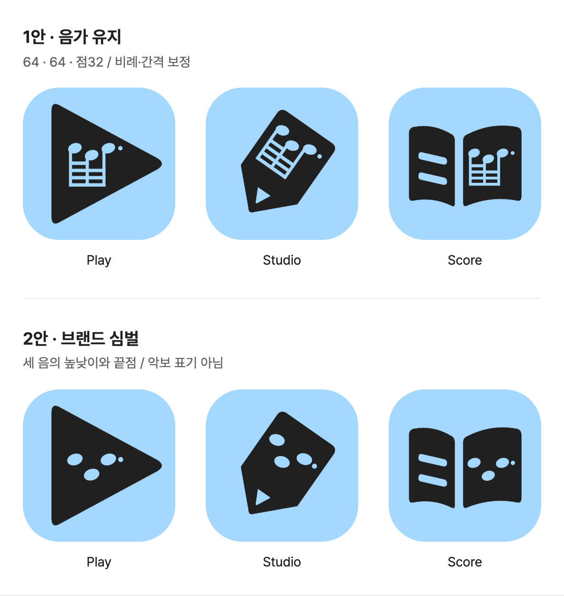

# 후보 07 · 음형 단순화 두 방향

2026-10-24. 사용자가 요청한 1번(음가 유지·조형 보정)과 2번(브랜드 심벌 축약)을 같은 앱 외곽에 적용했다. 새 검토 후보이며 기존 승인 음형·후보 06·실제 런처는 변경하지 않았다.



[인터랙티브 비교 화면](index.html) · [크기별 비교](evidence/sizes.png) · [배치 원본](family.json) · [파일 목록](generated/manifest.json)

## 1안 · 음가 유지

[편집 가능한 음형 SVG](motifs/precise.svg). 원본 64·64·점32의 구조를 유지하되 비례를 보정했다.

- 세 머리: 반경 21×14 → 22×16, 중심 y=68/92/68 → 80/102/80. 높고–낮고–높은 관계와 -18° 기울기는 유지한다.
- 기둥: 두께 9 → 10, 끝은 y=202. 머리를 아래로 옮겨 머리와 빔 사이 빈 구간을 짧게 만들었다. 머리 접합 지점에서 시작하므로 위로 기둥이 돌출되지 않는다.
- 빔: 두께 10 → 11, 수직 간격 20 → 23. 빔 사이 빈 간격은 10 → 12. 최상단 부분 빔은 첫 두 기둥에만 연결되며 아래 세 빔은 모두 연결된다.
- 점: 반경 6 → 7. 오른쪽 기둥도 최하단 빔의 끝까지 이어진다.

큰 크기에서는 정확한 음악 기호가 남고, 기존보다 머리·점과 빔 간격이 조금 더 분명해진다. 다만 네 겹 빔이라는 구조 자체는 같아서 **16–32px에서 음가를 읽기 어렵다는 한계를 해결했다고 주장하지 않는다.**

## 2안 · 브랜드 심벌

[편집 가능한 축약 SVG](motifs/gesture.svg). 기둥과 빔을 모두 제거하고 세 타원과 마지막 점을 남겼다.

- 타원 반경 25×18, 중심 y=110/158/110. 작은 크기에서 높낮이 차이가 보이도록 간격을 벌렸다.
- 마지막 점 반경 8. 원본의 점을 연상시키는 끝점이며 음가를 의미하는 부점으로 정의하지 않는다.
- 다른 음가의 음표로 대체한 안이 아니다. **음악 표기가 아닌 별도의 브랜드 심벌**이다.

빈 공간이 늘고 표정 같은 가벼운 인상이 생긴다. 작은 크기의 단순한 점 무늬로는 더 잘 남지만 음악 서비스라는 단서는 약해진다. 특히 Studio·Score에서 점 무늬·장식으로 읽힐 위험이 있다. 원본 음형을 모르는 사람이 띠로리를 떠올릴지는 검증하지 않았다.

## 비교 조건과 현재 판단

두 안 모두 후보 06의 Play·Studio·Score 외곽, 내부 배치 변환, 블루(#A5D8FF)·잉크(#202020)를 그대로 쓴다. 외곽·배치의 동일성은 자동 검사한다. 연필 비례 개선이나 Play 크기 조정은 이번 비교에 섞지 않았다. 두 심벌의 세부 비례와 점유 높이는 의도적으로 다르다.

직접 본 큰 이미지와 16–128px 비교에서는 **1안을 앱 아이콘의 우선 후보**로 본다. 음악이라는 기능 단서를 유지하기 때문이다. 2안은 더 가볍고 귀엽지만 의미 손실도 커서, 축약 심벌을 선택하려면 그 손실을 받아들일 수 있는지 먼저 확인할 필요가 있다. 어느 쪽도 사용자 승인·식별 테스트 완료 상태가 아니다.

## 제작·검증

```sh
node docs/brand/ddirori-brand-system/icon-family-v7/tools/build.mjs
/tmp/ddirori-brand-tools/venv/bin/python docs/brand/ddirori-brand-system/icon-family-v7/tools/verify.py
node docs/brand/ddirori-brand-system/icon-family-v7/tools/review.mjs
```

기존 `/tmp/ddirori-brand-tools`의 Resvg·Pillow·Playwright와 로컬 Chrome, 저장소 루트를 제공하는 localhost:8076 서버를 사용한다. 제품 의존성은 변경하지 않는다. `build.mjs --out <폴더>`로 독립 재생성이 가능하다.

- [자산 검사](evidence/verification.json): 생성 175개 파일 해시, PNG 144개 크기·배경 알파, 1안 음악 구조, 2안 기둥·빔 제거, 기존 외곽 보존, 6개 조합의 음형이 외곽 안에 축 방향 최소 3px 여유를 두고 들어가는지 확인.
- [리뷰 검사](evidence/browser.json): 6크기 × 2마스크 × 2색 모드, 이름 숨김·어두운 배경·대체 텍스트·이미지 로드, 390px 페이지 넘침·리소스 오류 확인.
- 두 안의 전체 비교 및 크기별 PNG를 직접 확인. 독립 재생성과 생성 해시 일치 확인.
- SVG 내부 마스크로 음형을 투명 여백으로 구성했다. 외부 이미지 의존성이 없다. 플랫폼별 마스크 경로 변환·패키징·실기기 설치는 이번 작업에 포함하지 않는다.
- 이전 후보·모브랜드 원본·제품 코드·UI 토큰·iOS 메타데이터를 유지한다. 커밋·푸시·배포하지 않는다.
