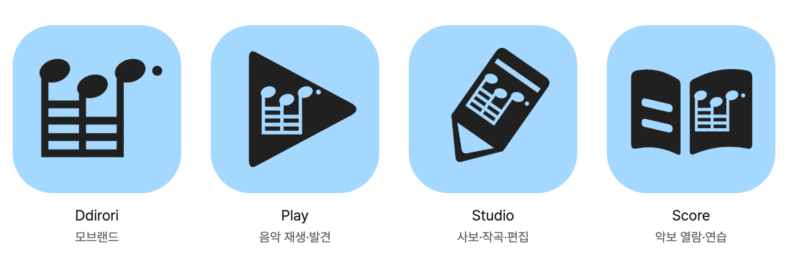

# 후보 08 · 모브랜드와 세 앱

2026-10-24. 후보 07의 1안을 기준으로 Play·Studio·Score 외곽과 여백을 다듬고 Ddirori 모브랜드 아이콘을 추가했다. 디자인 검토 후보이며 최종 승인·제품 적용·대표색 확정을 의미하지 않는다.



[리뷰 화면](index.html) · [전후 비교](evidence/before-after.png) · [크기별 비교](evidence/sizes.png) · [외곽·배치 원본](family.json) · [음형 마스터](motifs/precise.svg) · [생성 파일 목록](generated/manifest.json)

## 추천 구성

**모브랜드의 독립 음형 + Play의 삼각형 + Studio A의 연필 + Score의 펼친 악보**를 추천한다. 같은 블루·잉크와 같은 음형을 공유하되, 모브랜드는 음형 자체를 양각처럼 보여주고 앱은 기능의 큰 면에서 음형을 파낸다. 삼각형·사선 연필·책의 윤곽으로 앱을 구분한다.

### Ddirori · 모브랜드

기능 도형·텍스트·배지 없이 음형을 단독 배치했다. 256 좌표계에서 `translate(-4 -17) scale(1.08)`을 사용한다. 실제 음형 경계는 40,51–227,202로 앱 내부보다 넓다. 기하학적 박스의 중심뿐 아니라 오른쪽 점과 왼쪽에 몰린 빔의 무게를 함께 보며 배치했다. 잉크 중심을 캔버스 중앙으로 강제하면 오른쪽 점이 가장자리에 몰리므로 그렇게 하지 않았다.

음형의 선과 머리 자체가 주인공이어서 세 앱의 공통 자산이라는 위계가 생긴다. 브랜드 소개·서비스 선택·프로필·파비콘용 검토 후보이며 새 모브랜드 앱이 존재한다는 뜻이 아니다. 바흐·워드마크·기존 승인 모브랜드 음형 원본은 보존했다. 별도 컨셉을 추가할 필요가 없어 모브랜드는 한 안을 다듬었다.

### Play

기존 음형의 배치·크기는 그대로 두고 삼각형 외곽만 줄였다. 실제 경계는 48,27–234,229에서 58,39–222,217로 줄었다. 256px 알파 128 이상 잉크 비율은 26.86%에서 19.80%로 줄었다. 음형까지 함께 축소하지 않아 음악 단서는 유지한다. 삼각형과 원형 음반을 중복 사용하지 않는다.

### Studio · A 추천

[두 연필 비교](evidence/studio-options.png).

- A: 회전 전 몸통 폭 116 → 96. 위쪽 시작은 48 → 40으로 올려 몸통을 길게 하고, 작은 삼각형 구멍을 넓은 목재 여백과 검은 끝으로 바꿨다. 상단의 짧은 띠가 연필의 위아래 구분을 보강한다. 음형은 몸통에 맞춰 0.53 → 0.46배로 줄이고 위치를 조정했다.
- B: 폭 88의 더 좁은 몸통, 상단 띠 없음, 음형 0.43배. 단순하지만 내부 음형이 더 작아지고 필기 도구라는 단서가 약해 A를 추천한다.

두 안 모두 한 개의 외곽 안에 같은 음형을 담는다. 기존 음표+연필 병렬 구성으로 돌아가지 않았다. A의 좁고 긴 몸통과 끝부분은 이전의 태그 인상을 줄인다고 판단했다. 다만 실제 사용자의 연필/마커/태그 인식은 검증하지 않았으며, 넓은 연필이라는 해석이 여전히 필요할 수 있다.

### Score

펼친 악보 구조는 유지한다. 외곽을 189×137에서 184×132 경계로 소폭 정리하고, 페이지의 중앙 틈과 곡선을 맞췄다. 음형 배치는 이전보다 x=-1, y=-3 이동했으며 크기는 0.45배로 유지한다. 왼쪽 줄 간격은 34 → 31로 줄여 페이지 안에서 내용을 모았다. 오른쪽 음형의 확대를 위해 페이지를 더 비대칭으로 만들지 않았다.

## 공통 음형과 소형 한계

`motifs/precise.svg`는 후보 07의 1안과 바이트 단위로 동일하다. 이번 작업에서 머리·기둥·빔·점의 조형은 추가 수정하지 않았다. 모든 아이콘은 같은 마스터를 읽으며 크기·위치·Studio의 전체 회전만 다르다.

보존: 높고–낮고–높은 세 머리, 64·64·점32, 최상단의 짧은 빔, 아래쪽 세 공통 빔, 최하단까지 이어지는 세 기둥, 마지막 점, 머리 접합.

16·24·32·48·64·128·256·512px를 생성했다. 소형을 다른 음가나 점 없는 음형으로 대체하지 않는다. 모브랜드는 큰 음형 덕에 앱 내부보다 형태가 잘 남지만 **16px에서 정확한 음가 판독을 보장하지 않는다. 앱 내부는 16–32px에서 빔·점이 뭉개진다.** 작은 목록에는 이름을 병기하고, 48·64px에서도 음악적 의미를 실제 사용자가 읽는지 확인해야 한다. 이번에는 소형 전용 마스터를 따로 만들지 않았다.

외곽이 같은 면적으로 보이도록 강제하지 않았다. 모브랜드의 잉크 면적 17.45%, Play 19.80%, Studio 16.93%, Score 25.57%는 보정의 참고값이다. 면적이 같다고 같은 무게로 보이는 것은 아니다.

## 색상·파일 구조

- 블루 `#A5D8FF`, 잉크 `#202020`: 현행 팔레트 원본의 blue 항목을 읽는다. 최종 대표색 승인 아님.
- `family.json`: 네 추천 아이콘 및 Studio B의 외곽·내부 여백·음형 배치.
- `motifs/precise.svg`: 공유 음형. 이전 원본은 덮어쓰지 않음.
- `generated/blue`, `mono`, `transparent`: 각 후보의 SVG와 크기별 PNG. 모브랜드는 `brand` 파일명 사용.
- `generated/diagnostics`: 외곽과 음형을 분리한 검사 래스터.
- `generated/manifest.json`: 145개 생성 파일 해시와 원본 관계.
- `evidence/`: 최신 비교 이미지·자동 검사·보존 기준.

SVG의 내부 마스크로 앱 음형을 실제 투명 여백으로 만든다. PNG에 이미 마스크를 적용했으며, 리뷰 화면의 둥근 사각형·원형은 CSS로 표현한다. Android VectorDrawable 등은 마스크를 차집합 경로로 변환해 별도 검증해야 한다. 이번에는 플랫폼 설치 자산을 내보내거나 실제 런처를 교체하지 않았다.

## 재생성·검증

저장소 루트에서:

```sh
node docs/brand/ddirori-brand-system/icon-family-v8/tools/build.mjs
/tmp/ddirori-brand-tools/venv/bin/python docs/brand/ddirori-brand-system/icon-family-v8/tools/verify.py
node docs/brand/ddirori-brand-system/icon-family-v8/tools/review.mjs
```

기존 `/tmp/ddirori-brand-tools`의 Resvg·Pillow·Playwright와 로컬 Chrome을 재사용한다. 제품 의존성은 변경하지 않는다. 리뷰는 저장소 루트의 localhost:8076 서버를 사용한다. 서버가 없으면 `python3 -m http.server 8076 --bind 127.0.0.1`로 시작한다. `build.mjs --out <임시 폴더>`로 독립 재생성할 수 있다.

[자산 검사](evidence/verification.json):

- 원본 해시 및 145개 생성 파일, PNG 120개 크기·불투명/투명 알파.
- 후보 07과 공통 음형의 완전 일치 및 음가·빔·기둥·점 구조.
- 내부 음형이 외곽에서 최소 3px 여유를 갖는지 256px 래스터로 검사.
- 원형 마스크 가장자리로부터 최소 4px 안전 여유.
- 의도하지 않은 작은 조각·분리 검사. 음형을 파내면 빔 사이에 생기는 다섯 검은 영역은 정상적인 구조다.
- 시작 시 기록한 기존 파일 4,235개 및 HEAD·워크트리 보존. 최신 후보를 안내하는 상위 문서 세 곳만 갱신 허용.

[리뷰 검사](evidence/browser.json): 6크기 × 2마스크 × 2색 설정, 전후 7개 이미지 로드·표시 크기·대체 텍스트, 이름 숨김·어두운 배경·측정값 표시, 390/320px 페이지 넘침·리소스 오류 확인. 작은 화면의 비교 행은 내부 가로 스크롤을 제공한다.

직접 확인: 네 아이콘 최신 세트, Studio A/B, 전후 비교, 실제 크기별 이미지. 자동 검사는 식별 테스트를 대신하지 않는다.

독립 재생성 해시 일치, 로컬 문서 링크, `git diff --check`로 마무리한다. 이전 시각 회귀 기준은 변경하지 않는다.

미실시: 사용자 식별·기억 테스트, 실기기 설치·VoiceOver/TalkBack, 플랫폼 컴파일·Icon Composer·원격 CI. 제품 코드·UI 토큰·런처·iOS 메타데이터는 변경하지 않았다. 커밋·푸시·배포하지 않는다.

## 사용자에게 확인할 선택

**새 Studio A가 이전보다 연필·음악 편집 도구로 분명하게 읽히는가?** 모브랜드와 세 앱의 연결 구조는 유지하면서, 이 판단을 먼저 확인하고 최종 외곽을 좁히는 것을 권한다.
