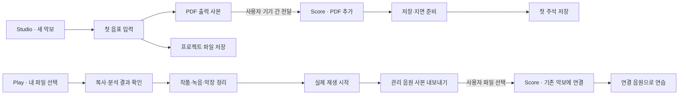

# 전체 여정과 첫 성취

## 경험의 중심

한 앱에서 한 가지를 해내는 경험을 먼저 제공한다. 작업과 관련된 순간에만 다른 도구로 이어간다. 통합 홈·로그인·앱 설치 목록을 첫 화면의 관문으로 만들지 않는다. 모든 화면에 제품군 배너를 붙이지 않는다.

| 여정 | 진입 순간 | 사용자에게 남는 결과 | 성공 조건 |
| --- | --- | --- | --- |
| F01 Play | 빈 라이브러리 또는 관리의 가져오기 | 내 음원·직접 확인한 작품/녹음/악장·재생 상태 | import 복사/등록 persistence 후 실제 engine playing callback |
| F02 Score | 빈 악보함/PDF 수신 | 앱 내부 PDF와 첫 연습 표시 | PDF ready 후 annotation store의 실제 저장 성공 |
| F03 Studio | 시작 화면의 새 악보 | 입력한 음표와 편집 가능한 프로젝트 파일 | 저장 결과가 현재 document generation/snapshot에 대응 |
| J01 PDF | Studio의 내보내기 결과 주변 | Score에서 독립적으로 보관한 PDF | export success와 receiver import success를 별개 판정 |
| J02 음원 | Play의 관리 파일 내보내기 또는 Score의 연결 음원 빈 상태 | 특정 악보의 연결 음원 사본 | 상대 악보 선택·파일 복사·metadata 저장 후 재생 준비 |

J01은 ‘만든 악보를 연습한다’는 목적과 형식이 명확하다. J02는 오디오·악보를 함께 쓰는 실제 기능을 연결하며 공유 ID 없이도 사용자가 대상 악보를 고를 수 있다. 관련 녹음을 자동 탐색하는 여정은 없는 계약을 만들어야 하므로 우선순위에서 제외했다.

## 단계 이탈·재방문

- 처음 실행: 하나의 주요 행동, 현재 지원하는 대안만 보조 행동. 바흐는 빈 상태에서 선택적으로 사용.
- 선택 취소: 자료·현재 화면 유지. 오류나 첫 성공으로 계산하지 않음.
- 가져오기 완료/정리 전: 이미 보관한 파일이 보이도록 복귀. 다음 정리는 선택 가능하며 내용을 반복 복사하지 않음.
- 뷰어 열기 실패: 가져온 악보는 목록에 남고 파일 복구로 연결. 실패 후 빈 상태로 되돌아가 자동 재가져오기를 유도하지 않음.
- 저장 실패: document/annotation draft·선택·페이지·undo를 보존. 실제 성공 전 완료 연출 없음.
- 기존 사용자: 홈·최근 파일·기존 자료로 바로 진입. 신규 소개 단계 강제 표시 없음.
- 전달받은 PDF: native 경로에서는 import 결과를 먼저 확인한 뒤 문서로 진입. 수동 전달은 picker에서 사용자가 파일 선택. 두 경우를 혼합하지 않음.
- 다른 앱 이동: 출발 앱은 자기 저장·재생·페이지 상태를 유지. 일반 OS 복귀와 실제 return resolver는 구분. 앱 간 재생 동기화 없음.

## 첫 성취의 관찰 지점

설계 관찰 항목이며 분석 SDK를 구현하거나 개인정보를 수집하지 않는다.

| 의도 | 완료 근거 | 수집하면 안 되는 원문 |
| --- | --- | --- |
| 파일 가져오기 | 실제 import batch 결과·새 자료 개수 | 경로·파일 내용·사용자 작품명 |
| 작품 정리 | catalog transaction 결과 | 개인 교정값·전체 metadata |
| 첫 재생 | engine playing snapshot | 매 tick 위치 로그·음원 내용 |
| 첫 주석 | annotation persistence 결과 | 주석 내용·문서 raster |
| 첫 프로젝트 저장 | 현재 snapshot 저장 성공 | 악보 내용·비공개 저장 경로 |
| 서비스 전달 | source outcome와 receiver outcome를 각각 | 설치 앱 전체 목록·임의 추적 ID |

샘플·테스트 fixture 성공은 실제 사용자 자료 성취와 구분한다. 실제 사용자 측정이 필요해지면 수집 목적·정책·동의 범위를 별도로 정한다.
