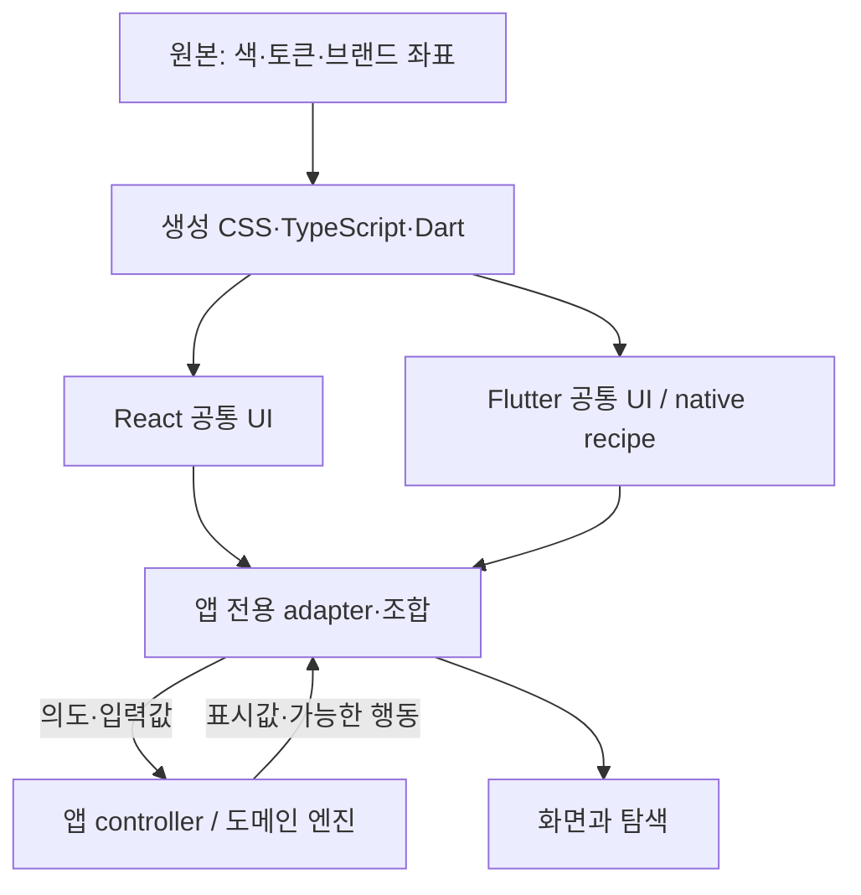

# A-01 책임·의존·상태 경계

설계 상태: 현행 구조를 유지하는 목표 계약. 검증: 소스 대조; 각 앱 전체 이행은 별도.

화살표는 제공되는 데이터/자산 흐름이다. 코드 import는 소비자가 제공자를 참조한다. UI 패키지가 E/F/G를 import하는 역의존은 금지한다.

| 계층 | 소유 | 금지 | 변경 판단 |
| --- | --- | --- | --- |
| A Foundations | 의미 역할, 모션, 지면과 UI의 분리 | 앱별 하드코딩 색을 새 공통 기본으로 채택 | 원본 변경·alias 검증·소비 영향 필요 |
| B 플랫폼 공통 | 입력 draft, 열림, focus, 내부 pending 등 일시 UI 상태 | SQLite·파일·인증·오디오·Score/Recording 모델 | 실제 플랫폼 계약 안에서 구현 |
| C 공통 조합 | 검색+필터+목록, 설정 검증·복구의 배치 recipe | 검색 엔진·저장소를 호출하는 범용 화면 | 같은 의미·상태 전이가 재사용되는가 |
| D 서비스 전용 | 도메인→표시 변환, 대상 ID, 명령 enabled, 문구 | 공통 컴포넌트 소스 복제 | 앱 presentation/adapter 안에서 합성 |
| E 도메인 엔진 | 영속 상태·권한·명령·작업 취소·오디오 시계 | 위젯 rebuild를 실시간 시계로 사용 | 기존 엔진 테스트와 제품 정책 |

## 상태와 이벤트

공통 `value`는 host 소유다. 탐색 active/draft는 UI 소유이며 commit callback이 요청일 뿐 영속 성공은 아니다. React Button 내부 pending과 host의 저장 상태를 구분한다. 위젯 해제는 네트워크 취소가 아니며 취소 가능성·중복 요청·오래된 응답 억제는 host가 담당한다. 오류 후 입력·대상 ID를 보존하고 명시적인 재시도를 제공한다. 회복 불가능한 권한/삭제 대상은 오류를 설명하고 새 행동을 선택한다.

모달·popup focus는 해당 플랫폼 UI가 관리한다. PDF 페이지·사보 선택·재생 위치의 복귀는 앱이 관리한다. DOM focus 복귀를 악보 선택 변경으로 해석하지 않는다. 진단 경로·오류 stack을 기본 제목/semantics에 포함하지 않는다.

## 승격과 예외

두 실제 소비 지점에서 의미·상태 전이·접근성 계약이 같고, 도메인 타입 제거 후에도 이름과 API가 자연스러우며, 양쪽 회귀 근거가 있을 때 승격한다. 코드 줄 수나 외형 유사성만으로 승격하지 않는다. `PlayQueueRow`와 `PlayMovementRow`는 현재 항목·순서·파일 정책이 달라 분리한다. `ScoreTile`, `SpanProperties`, metadata 교정 폼은 앱에 둔다. 기존 `DdiroriAnnotationTools`는 도메인 독립 도구 표시 조합으로 이미 공개됐지만 지원 tool/width 집합이 제한되므로 실제 앱 전체 기능을 축소해 맞추지 않는다.

예외 기록은 ID, 소유 앱, 이유, 영향 토큰/상태, 근거 파일, 종료 조건, 테스트를 포함한다. 예: Studio 가변 dock은 layout.panelWidth 기본과 다르며 사용자 저장 폭을 보존한다. 공통 승격 전까지 앱에만 노출한 DTO가 공개 패키지 API로 유출되지 않게 한다.
