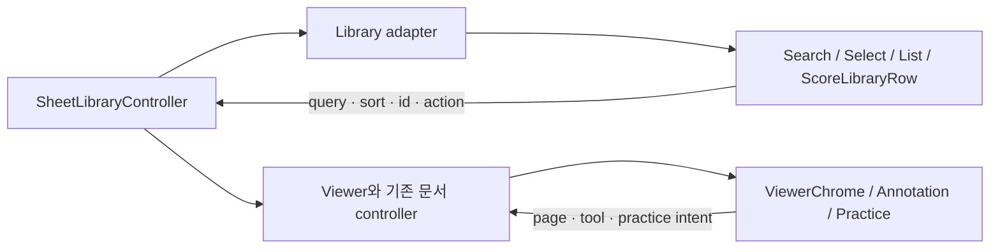

# S-SCORE 악보 열람·연습

소스: [main.dart](../../../../../apps/in_c_sheet/lib/main.dart), [제품 README](../../../../../apps/in_c_sheet/README.md). Flutter/iOS·Android. 현재 공통 테마·검색·상태와 악보함 목록/필터/빠른 접근을 도입했다. 아래 확대된 전용 facade는 **후속 설계**이며 실제 적용 범위는 다음과 같다. private 위젯의 기존 모델·행동을 유지하며 adapter로 점진 전환한다. 참조 공통: C04/C08/C11/C19/C24/C27/C36~C39.

## 표시 API와 상태 소유권

아래는 목표 API이며 현재 공개 클래스가 아니다. Dart record/enum으로 앱 내부에 둔다. `id`는 String, page는 int(1-based), counts는 int?, duration은 Duration?, flags는 bool. 모든 callback은 void이며 비동기 결과 상태는 controller의 다음 snapshot으로 반영한다. 공통 패키지로 SheetScore 타입을 이동하지 않는다.

```dart
// 제안: apps/in_c_sheet/lib/presentation/ 안의 표시 모델
// 제목은 원문 전체, subtitle은 adapter가 의미 단위로 포맷한다.
typedef ScoreRowView = ({String id, String title, String subtitle,
  bool favorite, bool pinned, bool selected, bool available, int? pageCount});
// ScoreLibraryRow({required ScoreRowView view, required bool selecting,
//   required VoidCallback onOpen, required ValueChanged<bool> onSelected,
//   required ValueChanged<bool> onFavorite, required VoidCallback onMenu});
```

onOpen과 favorite/menu는 서로 전파되지 않는다. visible rows가 바뀌어도 선택 ID는 controller 정책을 따르고 사라진 파일을 첫 항목으로 바꿔 열지 않는다. disabled/unavailable는 onOpen을 차단하되 복구 메뉴 제공 여부는 파일 정책으로 별도 결정한다.

## 전용 컴포넌트

| ID / 실제 연결 | 목표 anatomy·치수 | 입력·이벤트 | 상태·경계·접근성 |
| --- | --- | --- | --- |
| S-SCORE-01 LibraryRow/Grid · _ScoreTile/_ScoreGrid | thumbnail 또는 선택 checkbox → title16/600 → meta14 → 독립 actions. rowPadding16/gap12, flat 목록. grid는 가용 폭·큰 글자에 따라 열 감소 | ScoreRowView, selecting; open(id), select(id,bool), favorite(id,bool), menu(id) | thumbnail 실패는 악보 glyph. 긴 제목 wrap·고정 높이 금지. 파일 unavailable 문구+glyph. checkbox label에 제목 포함 |
| S-SCORE-02 QuickAccess · _QuickAccessBand/_QuickAccessScoreChip | 최근/고정 제목 → 짧은 실행 항목; compact chip은 명령이며 selected 필터가 아님 | ordered{id,title,available}[], onOpen(id) | 빈 그룹 숨김, 현재 파일 삭제는 가용성 갱신. 키보드와 터치 영역48. 최근 순서는 앱 계산 |
| S-SCORE-03 LibraryControls · _LibraryViewBar/_LibraryFacetExplorer | Search → sort Select → filter chips → 선택 개수/작업; gap12/section24 | query, sortId, activeFilters, facetCounts, selectedIds; onQuery/onSort/onFilters/onBulk | filter와 selection 분리. query 변경으로 자동 파일 열기 없음. 검색 결과0은 초기화, 초기 자료0은 가져오기 |
| S-SCORE-04 ViewerChrome · _ViewerControls/_PerformanceQuickActions | 문서 주변 toolbar/page controls; performance는 필수 이동만 남김. safe area 보호 | page/count?, modes, canPrevious/Next, loading/problem; onPageRequest/onMode/onExitPerformance | unknown count/hidden pages/setlist 순서 매핑은 controller. 첫/끝 차단. 숨긴 편집 도구 focus 제외; 모드 종료 trigger로 복귀 |
| S-SCORE-05 AnnotationBar · _AnnotationToolbar | tool + stroke color/width + undo/redo. UI glyph18/20, stored style 별도 | tool enum의 UI id, color ARGB, width(문서 단위), canUndo/Redo; onTool/onColor/onWidth/onUndo/Redo | 공통 AnnotationTools의 pen/highlight/erase 외 text 등 기능 유지. mixed·전체 없음 별도. 주석 저장 실패는 문서 유지+retry |
| S-SCORE-06 PracticePanel · _MetronomeSheet/_LinkedAudioPlayerSheet/_TunerSheet | Number+Beat, Transport, tuner/profiles를 섹션으로. 수치 numeric, touch48, 긴 프로필 wrap | 현재 엔진 snapshot→BPM/beat, Duration, tunerStatus/cents/note/permission | 시작 명령 후 실제 running 확인. noSignal·lowConfidence 분리, mic denied에는 설정/재시도. UI animation으로 박 계산 금지 |

## 조합과 이벤트 전이



- 불러오기: idle → file picker → reading(actual progress?) → library update. 취소는 성공/오류 안내 없이 기존 목록 유지. 실패는 파일명+복구, 절대경로 기본 비노출.
- 선택: selecting 진입 → stable ID 집합 변경 → bulk action → 확인 → processing → 성공 후 선택 갱신. 실패 때 집합과 오류 맥락 유지. 숨겨진 필터 결과의 선택 유지 여부는 기존 controller 정책을 보존하고 안내한다.
- 보기: onOpen(id) → loading → document/error. PDF zoom/rotation/half-page/hidden pages와 page request를 UI 번호로 역산하지 않는다.
- 주석: tool 설정 → engine stroke → 저장 snapshot. undo/redo는 engine stack이며 UI chip 상태 history가 아니다.
- 연습: 명령 요청 → engine pending/running/error. 재생·메트로놈·튜너 자원 충돌 정책은 현재 엔진을 따른다.

## 반응형·문구·서비스 연결

악보함은 gutter16/넓은32, 기존 max640/전환720 등 제품 예외를 첫 이행에서 보존한다. 긴 제목과 200%에서 grid→list 전환을 명시적으로 검토한다. 문서 지면은 UI 다크 전환과 독립이다. 모바일 BottomSheet keyboard inset과 safe area, tablet/keyboard focus, 펜 stroke와 toolbar touch를 각각 확인한다.

Play로 연결하는 콘텐츠는 안정적 파일/작품 식별 매핑이 확인된 경우만 제공한다. 임의 경로를 다른 앱에 넘기지 않는다. 연계가 없으면 ServiceLink unavailable/설치 안내만; 사용자 파일 동기화를 약속하지 않는다.

## 실제 이행·수용 조건

첫 범위는 LibraryRow+LibraryControls 한 화면. _ScoreTile의 모든 보조 행동을 목록으로 확인한 뒤 adapter에 매핑한다. 기존 controller·저장 schema·PDF 엔진은 그대로 둔다. 다음 ViewerChrome, 마지막 Annotation/Practice 순으로 진행한다. rollback은 해당 builder/adapter를 기존 구현으로 되돌리는 단위이며 데이터 역변환이 필요하면 실패한 설계다.

| Given / When | Then / 검증 |
| --- | --- |
| 긴 한영 제목·200%, favorite action | 제목/조작 모두 노출, 열기/선택 오발 없음; widget+시각 |
| 필터 결과 없음, 초기화 | 자료는 삭제되지 않고 query/filter만 변경; controller 회귀 |
| 첫/끝/숨김 페이지, pedal/키 입력 | 기존 이동 순서 보존; 제품 통합·실기기 |
| 줌/회전/반쪽 보기 후 주석 저장·내보내기 | 좌표·색·굵기·출력 원본 의미 보존; PDF fixture 비교 |
| mic 거부/noSignal/오디오 실패 | 성공 상태나 stale meter 표시 금지; 엔진 fixture+기기 |
| 공연 모드 진입·종료 | 숨은 편집 tool focus 제거/종료 복귀; keyboard/semantics |

근거 테스트: [brand_pilot_test](../../../../../apps/in_c_sheet/test/brand_pilot_test.dart)와 앱 test/의 기존 controller·viewer 테스트를 변경 화면에 맞게 선정한다. API 존재를 실기기 통과로 보지 않는다. 실제 UI 변경 시 [clef manifest](../../../../../deployment/apps/clef/ios-metadata.yaml) 갱신과 metadata check는 [작업 패키지](../work-packages.md)의 필수 항목이다.

## 실제 적용 범위 · 2026-10-24

[score_library_components.dart](../../../../../apps/in_c_sheet/lib/presentation/score_library_components.dart)의 ScoreLibraryEntry/Row/Collection/Controls/QuickAccess를 main.dart에서 소비한다. _ScoreGrid는 모델→표시값·ID callback adapter로 남고 _ScoreTile과 기존 QuickAccess chip 구현은 대체했다. S-SCORE-01~03의 대표 흐름을 적용했으며 04~06 전체 이행은 아직 아니다.

- Entry 현행 필드: id/title/subtitle/details:String, favorite/pinned:bool. 선택 ID와 selecting은 별도 host 입력. available 필드는 아직 없으며 파일 가용성은 기존 viewer inspect 경로가 판단한다. placeholder glyph는 실제 썸네일 로딩 성공을 뜻하지 않는다.
- Collection은 lazy ListView, 넓은 화면은 가변 높이 두 열, 큰 글자에서는 한 열. 고정 높이로 제목을 자르지 않는다. row의 open/select/favorite/pin/action은 ID로 앱에 전달한다.
- 정렬·즐겨찾기는 바로 노출, 태그/컬렉션/그룹/별점은 `필터` 시트에서 기존 선택 경로로 진입. 활성 필터 수를 표시한다. 빠른 접근은 기본 접힘으로 목록을 우선한다.
- 선택 모드에서 제목/checkbox는 선택을 바꾸고 기존처럼 문서를 열지 않는다. 필터로 안 보이게 된 선택 ID는 유지한다. 선택을 취소하면 지운다.
- 일괄 편집은 결과 int를 반환하는 앱 sheet다. 처리 중 입력/취소/Back/drag/barrier를 차단, 실패 시 입력 유지+재시도. 성공 후에만 선택 모드를 끝낸다. 기존 controller의 persistence 정책·모델은 변경하지 않는다.
- `InCSheetApp.accent?`, `themeMode=system`은 검증/host 주입용이며 제품에 새 색 선택 설정을 추가하지 않았다. 기본 active palette는 그대로다.

[실제 앱 테스트](../../../../../apps/in_c_sheet/test/adoption_pilot_test.dart), [검수·이행 기록](../../adoption-pilot.md). 카탈로그 예제를 실제 PDF 렌더러 검증으로 대신하지 않는다.
