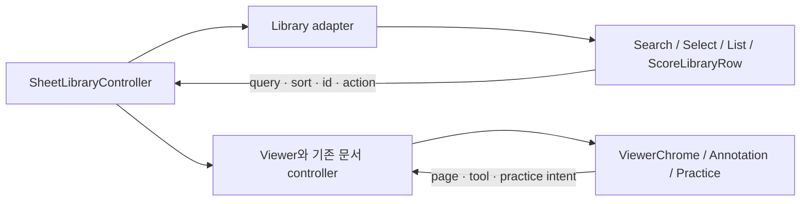

# S-SCORE 악보 열람·연습

소스: [main.dart](../../../../../apps/in_c_sheet/lib/main.dart), [제품 README](../../../../../apps/in_c_sheet/README.md). Flutter/iOS·Android. 현재 공통 테마·검색·상태와 악보함 목록/필터/빠른 접근을 도입했다. 아래 확대된 전용 facade는 **후속 설계**이며 실제 적용 범위는 다음과 같다. private 위젯의 기존 모델·행동을 유지하며 adapter로 점진 전환한다. 참조 공통: C04/C08/C11/C19/C24/C27/C36~C39.

## 표시 API와 상태 소유권

아래는 목표 API이며 현재 공개 클래스가 아니다. Dart record/enum으로 앱 내부에 둔다. `id`는 String, page는 int(1-based), counts는 int?, duration은 Duration?, flags는 bool. 모든 callback은 void이며 비동기 결과 상태는 controller의 다음 snapshot으로 반영한다. 공통 패키지로 SheetScore 타입을 이동하지 않는다.

```dart
// 제안: apps/in_c_sheet/lib/presentation/ 안의 표시 모델
// 제목은 원문 전체, subtitle은 adapter가 의미 단위로 포맷한다.
typedef ScoreRowView = ({String id, String title, String subtitle,
  bool favorite, bool pinned, bool selected, bool available, int? pageCount});
// ScoreLibraryRow({required ScoreRowView view, required bool selecting,
//   required VoidCallback onOpen, required ValueChanged<bool> onSelected,
//   required ValueChanged<bool> onFavorite, required VoidCallback onMenu});
```

onOpen과 favorite/menu는 서로 전파되지 않는다. visible rows가 바뀌어도 선택 ID는 controller 정책을 따르고 사라진 파일을 첫 항목으로 바꿔 열지 않는다. disabled/unavailable는 onOpen을 차단하되 복구 메뉴 제공 여부는 파일 정책으로 별도 결정한다.

## 전용 컴포넌트

| ID / 실제 연결 | 목표 anatomy·치수 | 입력·이벤트 | 상태·경계·접근성 |
| --- | --- | --- | --- |
| S-SCORE-01 LibraryRow/Grid · _ScoreTile/_ScoreGrid | thumbnail 또는 선택 checkbox → title16/600 → meta14 → 독립 actions. rowPadding16/gap12, flat 목록. grid는 가용 폭·큰 글자에 따라 열 감소 | ScoreRowView, selecting; open(id), select(id,bool), favorite(id,bool), menu(id) | thumbnail 실패는 악보 glyph. 긴 제목 wrap·고정 높이 금지. 파일 unavailable 문구+glyph. checkbox label에 제목 포함 |
| S-SCORE-02 QuickAccess · _QuickAccessBand/_QuickAccessScoreChip | 최근/고정 제목 → 짧은 실행 항목; compact chip은 명령이며 selected 필터가 아님 | ordered{id,title,available}[], onOpen(id) | 빈 그룹 숨김, 현재 파일 삭제는 가용성 갱신. 키보드와 터치 영역48. 최근 순서는 앱 계산 |
| S-SCORE-03 LibraryControls · _LibraryViewBar/_LibraryFacetExplorer | Search → sort Select → filter chips → 선택 개수/작업; gap12/section24 | query, sortId, activeFilters, facetCounts, selectedIds; onQuery/onSort/onFilters/onBulk | filter와 selection 분리. query 변경으로 자동 파일 열기 없음. 검색 결과0은 초기화, 초기 자료0은 가져오기 |
| S-SCORE-04 ViewerChrome · _ViewerControls/_PerformanceQuickActions | 문서 주변 toolbar/page controls; performance는 필수 이동만 남김. safe area 보호 | page/count?, modes, canPrevious/Next, loading/problem; onPageRequest/onMode/onExitPerformance | unknown count/hidden pages/setlist 순서 매핑은 controller. 첫/끝 차단. 숨긴 편집 도구 focus 제외; 모드 종료 trigger로 복귀 |
| S-SCORE-05 AnnotationBar · _AnnotationToolbar | tool + stroke color/width + undo/redo. UI glyph18/20, stored style 별도 | tool enum의 UI id, color ARGB, width(문서 단위), canUndo/Redo; onTool/onColor/onWidth/onUndo/Redo | 공통 AnnotationTools의 pen/highlight/erase 외 text 등 기능 유지. mixed·전체 없음 별도. 주석 저장 실패는 문서 유지+retry |
| S-SCORE-06 PracticePanel · _MetronomeSheet/_LinkedAudioPlayerSheet/_TunerSheet | Number+Beat, Transport, tuner/profiles를 섹션으로. 수치 numeric, touch48, 긴 프로필 wrap | 현재 엔진 snapshot→BPM/beat, Duration, tunerStatus/cents/note/permission | 시작 명령 후 실제 running 확인. noSignal·lowConfidence 분리, mic denied에는 설정/재시도. UI animation으로 박 계산 금지 |

## 조합과 이벤트 전이



- 불러오기: idle → file picker → reading(actual progress?) → library update. 취소는 성공/오류 안내 없이 기존 목록 유지. 실패는 파일명+복구, 절대경로 기본 비노출.
- 선택: selecting 진입 → stable ID 집합 변경 → bulk action → 확인 → processing → 성공 후 선택 갱신. 실패 때 집합과 오류 맥락 유지. 숨겨진 필터 결과의 선택 유지 여부는 기존 controller 정책을 보존하고 안내한다.
- 보기: onOpen(id) → loading → document/error. PDF zoom/rotation/half-page/hidden pages와 page request를 UI 번호로 역산하지 않는다.
- 주석: tool 설정 → engine stroke → 저장 snapshot. undo/redo는 engine stack이며 UI chip 상태 history가 아니다.
- 연습: 명령 요청 → engine pending/running/error. 재생·메트로놈·튜너 자원 충돌 정책은 현재 엔진을 따른다.

## 반응형·문구·서비스 연결

악보함은 gutter16/넓은32, 기존 max640/전환720 등 제품 예외를 첫 이행에서 보존한다. 긴 제목과 200%에서 grid→list 전환을 명시적으로 검토한다. 문서 지면은 UI 다크 전환과 독립이다. 모바일 BottomSheet keyboard inset과 safe area, tablet/keyboard focus, 펜 stroke와 toolbar touch를 각각 확인한다.

Play로 연결하는 콘텐츠는 안정적 파일/작품 식별 매핑이 확인된 경우만 제공한다. 임의 경로를 다른 앱에 넘기지 않는다. 연계가 없으면 ServiceLink unavailable/설치 안내만; 사용자 파일 동기화를 약속하지 않는다.

## 실제 이행·수용 조건

첫 범위는 LibraryRow+LibraryControls 한 화면. _ScoreTile의 모든 보조 행동을 목록으로 확인한 뒤 adapter에 매핑한다. 기존 controller·저장 schema·PDF 엔진은 그대로 둔다. 다음 ViewerChrome, 마지막 Annotation/Practice 순으로 진행한다. rollback은 해당 builder/adapter를 기존 구현으로 되돌리는 단위이며 데이터 역변환이 필요하면 실패한 설계다.

| Given / When | Then / 검증 |
| --- | --- |
| 긴 한영 제목·200%, favorite action | 제목/조작 모두 노출, 열기/선택 오발 없음; widget+시각 |
| 필터 결과 없음, 초기화 | 자료는 삭제되지 않고 query/filter만 변경; controller 회귀 |
| 첫/끝/숨김 페이지, pedal/키 입력 | 기존 이동 순서 보존; 제품 통합·실기기 |
| 줌/회전/반쪽 보기 후 주석 저장·내보내기 | 좌표·색·굵기·출력 원본 의미 보존; PDF fixture 비교 |
| mic 거부/noSignal/오디오 실패 | 성공 상태나 stale meter 표시 금지; 엔진 fixture+기기 |
| 공연 모드 진입·종료 | 숨은 편집 tool focus 제거/종료 복귀; keyboard/semantics |

근거 테스트: [brand_pilot_test](../../../../../apps/in_c_sheet/test/brand_pilot_test.dart)와 앱 test/의 기존 controller·viewer 테스트를 변경 화면에 맞게 선정한다. API 존재를 실기기 통과로 보지 않는다. 실제 UI 변경 시 [clef manifest](../../../../../deployment/apps/clef/ios-metadata.yaml) 갱신과 metadata check는 [작업 패키지](../work-packages.md)의 필수 항목이다.

## 실제 적용 범위 · 2026-10-24

[score_library_components.dart](../../../../../apps/in_c_sheet/lib/presentation/score_library_components.dart)의 ScoreLibraryEntry/Row/Collection/Controls/QuickAccess를 main.dart에서 소비한다. _ScoreGrid는 모델→표시값·ID callback adapter로 남고 _ScoreTile과 기존 QuickAccess chip 구현은 대체했다. S-SCORE-01~03의 대표 흐름을 적용했으며 04~06 전체 이행은 아직 아니다.

- Entry 현행 필드: id/title/subtitle/details:String, favorite/pinned:bool. 선택 ID와 selecting은 별도 host 입력. available 필드는 아직 없으며 파일 가용성은 기존 viewer inspect 경로가 판단한다. placeholder glyph는 실제 썸네일 로딩 성공을 뜻하지 않는다.
- Collection은 lazy ListView, 넓은 화면은 가변 높이 두 열, 큰 글자에서는 한 열. 고정 높이로 제목을 자르지 않는다. row의 open/select/favorite/pin/action은 ID로 앱에 전달한다.
- 정렬·즐겨찾기는 바로 노출, 태그/컬렉션/그룹/별점은 `필터` 시트에서 기존 선택 경로로 진입. 활성 필터 수를 표시한다. 빠른 접근은 기본 접힘으로 목록을 우선한다.
- 분류가 있는 라이브러리의 펼친 `분류별 찾기`는 컬렉션·그룹·별점마다 `DdiroriChoices`를 사용한다. 공통 surface/border/radius/spacing token을 따르며, 고정 폭 라벨이나 앱별 `ChoiceChip` 색을 만들지 않는다. 한 항목을 다시 선택하면 해당 분류만 해제하고, 분류 선택은 악보를 열지 않는다.
- 선택 모드에서 제목/checkbox는 선택을 바꾸고 기존처럼 문서를 열지 않는다. 필터로 안 보이게 된 선택 ID는 유지한다. 선택을 취소하면 지운다.
- 일괄 편집은 결과 int를 반환하는 앱 sheet다. 처리 중 입력/취소/Back/drag/barrier를 차단, 실패 시 입력 유지+재시도. 성공 후에만 선택 모드를 끝낸다. 기존 controller의 persistence 정책·모델은 변경하지 않는다.
- `InCSheetApp.accent?`, `themeMode=system`은 검증/host 주입용이며 제품에 새 색 선택 설정을 추가하지 않았다. 기본 active palette는 그대로다.
- 주석 옵션은 기존 도구·색·굵기·스탬프·layer·undo/redo 동작을 유지한 채 `DdiroriToolbar`의 tokenized surface와 focus traversal 안에 배치한다. 공통 `DdiroriAnnotationTools`의 제한된 도구 집합으로 기능을 축소하지 않는다.
- ViewerChrome의 페이지 이동은 `DdiroriPageControls`를 사용한다. 현재 mode label과 실제 이전/다음 가능 여부는 앱의 PDF·숨김 페이지·세트리스트 정책이 계산해 nullable callback으로 전달하며, 공통 컴포넌트는 PDF 페이지 순서나 controller를 추측하지 않는다.
- 공연 quick action과 자동 스크롤 cue는 앱이 공연 정책·세트리스트 순서·타이머 수명을 계속 소유한다. 다만 overlay, on-overlay text, 선택 강조, separator와 radius는 `DdiroriStyle`/score token을 사용해 테마 계약을 따른다.
- 페이지 메타 배지와 빠른 이동도 같은 overlay/on-overlay/control-radius token을 사용한다. jump point, 북마크, rehearsal mark의 실제 대상 페이지와 overflow 메뉴 구성은 Score adapter가 소유한다.
- Crop 설정 sheet는 공통 section-title/description, spacing, secondary/primary button을 사용한다. 네 방향 slider, crop 값 정규화와 원본 PDF 보존은 기존 Score controller가 소유한다.
- PDF 파일 상태/열기 실패는 `DdiroriStatePanel`을 사용한다. 제목·복구 안내는 기본 화면에 두고, 경로와 오류 상세는 선택 가능한 진단 정보로 접어 기본 노출을 줄인다. 재가져오기/백업 복구의 실제 동작은 기존 library 경로가 소유한다.
- 메트로놈 sheet는 `DdiroriPageHeader`, `DdiroriButton`, `DdiroriIconButton`, `DdiroriChoices`, `DdiroriSettingsRow`로 제목·시작/정지·BPM·박자·소리 설정의 위계를 맞춘다. 좁은 sheet와 큰 글씨에서 전체 제어를 스크롤로 접근할 수 있다. `Timer`, 현재 박자, BPM/박자 persistence와 기기 click 재생은 계속 Score가 소유하며, widget 검증은 실제 청감·latency 검증을 대신하지 않는다.
- 자동 스크롤 sheet는 `DdiroriPageHeader`와 `DdiroriButton`으로 실행·일시정지·재개·정지 행동의 위계를 맞춘다. pause marker·반복 구간·cue point의 긴 동작은 좁은 화면에서 제목 아래 별도 행으로 배치해 overflow 없이 접근한다. 페이지 범위·cue·반복·타이머와 실제 스크롤 엔진은 계속 Score가 소유하며, widget 검증은 실기기 스크롤 감각이나 페달·VoiceOver 검증을 대신하지 않는다.
- 튜너 sheet는 `DdiroriPageHeader`와 `DdiroriIconButton`으로 마이크 입력의 현재 시작/정지 행동을 표시한다. 프리셋·악기/표시·감지 프로필·드론 mode의 긴 선택값은 작은 폭에서도 말줄임으로 유지한다. 마이크 권한·음정 감지·드론 재생·실제 출력 품질은 계속 Score의 native adapter와 Device QA가 소유한다.
- 연결 음원 재생 sheet는 `DdiroriPageHeader`, `DdiroriButton`, `DdiroriStatusBadge`, `DdiroriBanner`로 파일명·재생 대기/실행/실패 상태와 재생/정지 행동을 분리한다. 앱 저장소의 절대 경로는 기본 화면에 표시하지 않는다. `SheetAudioPlayer`의 재생·정지·native channel 수명과 실제 codec/출력 품질은 계속 Score와 Device QA가 소유한다.
- 파트와 연결 파일 sheet는 공통 `showDdiroriSheet`, `DdiroriItem`, `DdiroriStatusBadge`, `DdiroriButton`, `DdiroriMenuButton`으로 현재 PDF·연결 파일·가용 상태·열기/역할 변경/연결 제거 행동을 구분한다. 기본 행에는 sandbox 절대 경로 대신 파일명만 표시한다. 파일 누락 또는 지원하지 않는 형식은 열기만 막고 metadata 역할 변경·연결 제거는 계속 가능하다. PDF 전환·이미지 보기·오디오 재생과 원본 보존은 기존 Score controller와 viewer adapter가 소유한다.
- 악보 메모 sheet는 공통 `DdiroriPageHeader`, `DdiroriInput`, `DdiroriAdaptiveActions`, `DdiroriButton`으로 공연/리허설/조율/편성 draft와 취소/저장을 구분한다. sheet 안의 draft는 저장을 누른 뒤 기존 `updateStructuredNotes` 경로로만 반영된다. 단일 scroll 문서는 큰 글씨에서도 모든 입력과 저장 행동을 생성·접근 가능하게 하며, metadata 저장 실패 처리와 PDF·주석·연습 상태 보존은 Score controller가 소유한다.
- 북마크 목록 sheet는 공통 `showDdiroriSheet`, `DdiroriBanner`, `DdiroriItem`, `DdiroriButton`, `DdiroriMenuButton`으로 이동과 이름 변경/삭제를 분리한다. 행 자체와 `이동`은 기존 PDF page controller 이동만 요청하며, 이름 변경/삭제는 기존 bookmark controller 경로를 그대로 사용한다. 큰 글씨에서 모든 항목과 행동은 scroll로 접근해야 하고, 북마크 목록을 여는 일만으로 PDF 문서나 메타데이터를 바꾸지 않는다.
- 숨긴 페이지 관리 sheet는 공통 `showDdiroriSheet`, `DdiroriBanner`, `DdiroriItem`, `DdiroriButton`으로 숨긴 쪽과 회전 metadata를 보여주고 `숨김 해제`를 명시한다. 해제와 대상 쪽 이동은 기존 page-settings/PDF controller가 소유하며, 목록을 열거나 닫는 일만으로 페이지 순서·원본 PDF·주석을 바꾸지 않는다.
- 페이지 순서/복제 sheet는 공통 `showDdiroriSheet`, `DdiroriBanner`, `DdiroriItem`, `DdiroriStatusBadge`, `DdiroriButton`으로 앱 내부 표시 순서와 숨김 상태, 위/아래/복제/기본값 복원을 구분한다. 모든 변경은 기존 page-order controller를 통해 저장하며 원본 PDF 파일·주석 좌표·연습 상태는 바꾸지 않는다.
- 점프 포인트와 대상 페이지 선택 sheet는 공통 `showDdiroriSheet`, `DdiroriBanner`, `DdiroriItem`, `DdiroriStatusBadge`, `DdiroriButton`, `DdiroriMenuButton`으로 현재 페이지의 추가, 이동 가능/숨김 상태, 이동과 이름 변경/삭제를 분리한다. 실제 페이지 이동과 점프 포인트 저장은 기존 Score controller/PDF adapter가 소유하며, 원본 PDF 파일·주석 좌표·연습 상태는 바꾸지 않는다.
- 리허설 마크 sheet와 편집 dialog는 공통 `showDdiroriSheet`/`showDdiroriDialog`, `DdiroriBanner`, `DdiroriItem`, `DdiroriStatusBadge`, `DdiroriInput`, `DdiroriChoices`, `DdiroriButton`, `DdiroriMenuButton`으로 추가·이동·수정/삭제와 마크 종류·페이지 입력을 구분한다. 공연 모드에서는 기존대로 이동만 허용하며, 저장과 실제 페이지 이동은 기존 Score controller/PDF adapter가 소유한다.
- 보기 방식 sheet는 공통 `showDdiroriSheet`, `DdiroriBanner`, `DdiroriItem`, `DdiroriStatusBadge`, `DdiroriButton`으로 현재 방식·선택 가능·좁은 화면의 2페이지 제한을 구분한다. display mode 저장, 자동 스크롤 정지, crop fit 재계산과 PDF invalidate는 기존 Score viewer가 소유한다.
- 표시 효과와 페이지 맞춤 sheet도 같은 공통 계약으로 현재 선택·선택 가능·표시 변경의 보존 범위를 구분한다. 효과/맞춤 저장, crop fit 재계산, PDF invalidate와 실제 색상·지면 배치는 기존 Score viewer가 소유하며, sheet를 열거나 닫는 일만으로 PDF·주석·페이지 위치를 바꾸지 않는다.
- 페달 매핑 sheet는 공통 `showDdiroriSheet`, `DdiroriBanner`, `DdiroriItem`, `DdiroriStatusBadge`, `DdiroriButton`으로 현재 매핑·선택 가능 매핑과 맞춤 입력 편집 진입을 구분한다. HID/키 입력 처리, 설정 저장, custom input action과 실제 USB·Bluetooth 페달 호환성은 기존 Score 입력 adapter와 Device QA가 소유한다.
- 직접 페달 설정은 공통 `DdiroriSettingsRow`, `DdiroriBanner`, `DdiroriAdaptiveActions`, `DdiroriButton`으로 진단 입력과 기본 입력의 동작 선택·저장을 구분한다. 작은 화면의 dropdown은 가용 폭을 채우며, 실제 key/HID ID 해석·저장과 장비 호환성은 기존 adapter와 Device QA가 소유한다.
- 렌더링 프로필과 페이지 넘김 효과 sheet는 공통 sheet·안내·행·상태·행동으로 현재 설정과 선택 가능 설정을 구분한다. 렌더링 cache/invalidate 정책, 페이지 전환 타이밍과 실제 PDF의 성능·표시 품질은 기존 Score viewer와 Device QA가 소유하며, sheet를 열거나 닫는 일만으로 PDF·주석·현재 페이지를 바꾸지 않는다.
- 좁은 화면의 `보기 옵션`은 공통 `showDdiroriSheet`, `DdiroriBanner`, `DdiroriSection`, `DdiroriItem`으로 빠른 접근·읽기와 연습·필기·페이지 편집·공유와 진단을 구획한다. 기존 `모든 도구` adapter는 `DdiroriIconButton`도 같은 이름·아이콘·enabled callback 계약으로 변환하며, 설정 저장·PDF 원본·주석·페이지·공연 정책은 계속 Score viewer가 소유한다.
- 넓은 화면의 `모든 도구 → 페이지 정리`도 공통 `DdiroriItem`과 `DdiroriMenuButton`으로 이름·아이콘·선택 메뉴를 표시한다. 메뉴의 실제 페이지 metadata 저장·적용 사본·공유와 입력 진단은 기존 Score viewer/controller가 소유하며, 공통 행을 여는 일만으로 PDF·주석·페이지를 바꾸지 않는다.
- `페이지 정리 → 입력 진단`은 공통 `showDdiroriSheet`, `DdiroriBanner`, `DdiroriSettingsRow`, `DdiroriItem`, `DdiroriButton`으로 최근 입력·현재 viewer 요약·로그 복사·직접 설정 진입을 표시한다. key/HID 해석, 로그 수집, 설정 저장과 실제 장비 호환성은 기존 Score 입력 adapter와 Device QA가 소유하며, 진단 sheet를 열거나 닫는 일만으로 PDF·주석·페이지를 바꾸지 않는다.
- `공연 설정`은 공통 `showDdiroriSheet`, `DdiroriBanner`, `DdiroriSection`, `DdiroriSettingsRow`, `DdiroriInput`, `DdiroriItem`, `DdiroriButton`으로 시작 전 확인·세트리스트 이동·공연 중 허용 도구·preset template을 구분한다. sheet 안의 toggle/template 선택은 draft이며 최종 저장 전에는 기존 viewer settings를 바꾸지 않는다. 공연 정책·preset 저장·실제 화면 켜짐 유지와 외부 장비 동작은 Score controller와 Device QA가 소유한다.
- 연결 음원 패널은 공통 `showDdiroriSheet`, `DdiroriItem`, `DdiroriStatusBadge`, `DdiroriBanner`, `DdiroriButton`으로 파일명·재생 상태·오류·재생/정지를 구분한다. 파일 경로를 기본 화면에 노출하지 않으며, `SheetAudioPlayer`의 native channel 수명·codec·출력 품질은 Score와 Device QA가 소유한다.

[실제 앱 테스트](../../../../../apps/in_c_sheet/test/adoption_pilot_test.dart), [검수·이행 기록](../../adoption-pilot.md). 카탈로그 예제를 실제 PDF 렌더러 검증으로 대신하지 않는다.

## 2026-10-30 연습 도구 후속 적용

- 자동 스크롤은 공통 `showDdiroriSheet`의 단일 스크롤과 `DdiroriSection`, `DdiroriSettingsRow`, `DdiroriIconButton`, `DdiroriChoices`, `DdiroriButton`으로 설정과 실행을 구분한다. 기존 페이지 범위·쪽별 속도·cue·pause·반복 저장과 스크롤 엔진은 Score가 소유한다.
- 메트로놈·튜너도 공통 sheet의 단일 제목·스크롤을 사용한다. 튜너의 마이크 시작/정지는 이름 있는 버튼으로 표시하며, native 입력/출력·음정 meter·연습 데이터는 기존 Score adapter가 소유한다.
- 악보 메모는 공통 Input·Banner·StatusBadge·AdaptiveActions·Button을 조합하고 실제 `updateStructuredNotes` 저장 완료 후에만 닫힌다. 저장 중 draft는 read-only이며 중복 요청·취소·Back·barrier/drag 닫기를 차단한다. 실패 시 원본과 draft를 유지하고 다시 시도하며 성공 안내는 완료 후에만 표시한다. 현재 공통 sheet API에 dismissal 제어가 없으므로 이 저장 폼의 native modal host는 앱이 소유한다.
- [실제 PDF 검증과 적용 기록](../../product-design-r3/returns/score-viewer-tools-20261030.md).
