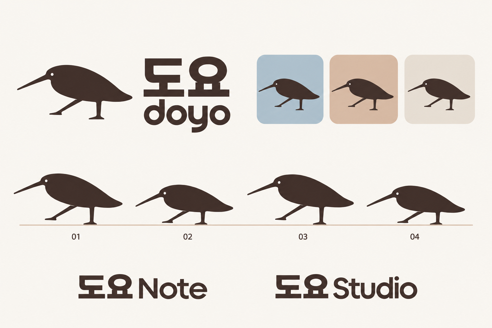

# 도요 로고와 리듬 실루엣 시안

2026-10-22 · 작업용 이름과 시각 탐색 · 제품 미적용

도요의 귀여움은 짧은 이름, 둥근 몸과 긴 부리, 다리를 접고 펴며 들썩이는 자세에서 만든다. 새 자체는 단일 색으로 표현한다. 사용자가 **A 코코아·블루그레이**를 기준 팔레트로 선택했다. 제품에는 아직 적용하지 않았다.

## 선택한 팔레트

- [색상·밝은 화면·다크 화면 비교](palette.html)
- [팔레트 적용 원칙](PALETTE.md) · [정확한 HEX 토큰](palette.json)
- 새와 글자 `#3E332F`, 대표 배경 `#A8BECC`, 종이색 `#F7F4EF`, 행동색 `#486879`.
- [선택안 로고](palettes/a-cocoa-bluegray.png) · [선택안 배너](palettes/a-rhythmic-banner.png).
- 현재 다크 조합은 검토용 파생안이며, 선택한 것은 A의 밝은 기준 팔레트다.

## 실루엣 검토 기록

- [로고와 네 가지 포즈 v4](monochrome-gait-study-v4.png): 배선을 올리고 가슴의 처짐을 줄여 얕고 길게 편 몸통. 머리와 부리를 앞으로 내민 리듬 포즈.
- [리듬 배너 v4](rhythmic-banner-v4.png): 같은 지지·내딛기 관계를 높음 → 낮음 → 높음으로 배치.
- [비교 화면](index.html): 최신 두 시안과 앞선 팔레트 실험을 함께 확인.
- 이전 자세 비교: [로고 v3](monochrome-gait-study-v3.png), [배너 v3](rhythmic-banner-v3.png), [로고 v2](monochrome-gait-study-v2.png), [배너 v2](rhythmic-banner-v2.png), [로고 v1](monochrome-gait-study.png), [배너 v1](rhythmic-banner.png).

## 형태와 움직임

| 요소 | 현재 방향 |
| --- | --- |
| 새의 색 | 코코아 계열 한 색. 날개·배의 색 분할을 제거 |
| 식별 단서 | 앞으로 뻗은 긴 부리, 뒤통수로 이어지는 둥근 등선, 배선을 올린 얕고 길어진 몸통, 다리 사이의 여백 |
| 기본 로고 후보 | 배와 가슴을 펴고 머리·부리를 앞으로 내미는 순간. 뒷다리는 수직으로 지지하며 앞발은 살짝 띄움 |
| 반대 포즈 | 몸이 낮아지며 앞발이 지면에 가까워진 자세 |
| 움직임 | 다리의 접힘·폄과 체중 이동으로 몸 높이가 변함 |
| 배너 | 같은 새의 보행 단계를 연속 배치 |
| 색상 | A 코코아·블루그레이 선택. 새는 단색, 배경·제품 표면에서 색을 사용 |

사용자가 제공한 세 장의 보행 레퍼런스와 이후의 자세 보정을 기준으로 삼았다. **수직으로 지지하는 뒷다리, 앞으로 펴는 앞다리, 앞발이 살짝 뜨는 차이와 몸의 높낮이**로 리듬을 표현한다. 뒤로 기댄 자세나 양쪽 다리가 대칭으로 벌어진 자세를 피한다. 등과 뒤통수는 하나의 둥근 윤곽으로 이어지게 유지한다. v4에서는 배선을 끌어올리고 가슴의 처짐을 줄이며, 머리와 부리를 앞으로 뻗어 몸을 펴는 박자를 표현했다. 부리는 아래로 깊게 떨어뜨리지 않고 완만한 하향으로 편다. 최종 모션에서는 몸통의 형태와 크기를 유지하고 다리와 몸의 위치 관계로 높이를 바꾼다. 이 네 포즈는 래스터 콘셉트이며 연속 애니메이션이나 최종 관절 원본이 아니다.

Figma에서는 기본 도형의 조합, 여백, 위계와 제품군 일관성을 참고한다. Figma의 고유 로고·팔레트는 사용하지 않는다. 참고 자료는 [제품 아이콘 제작](https://www.figma.com/blog/the-making-of-a-product-icon/)과 [시각 언어 개편](https://www.figma.com/blog/figma-on-figma-evolving-our-visual-language/)이다.

## 앞선 팔레트 실험

아래 이미지는 이전의 색 분할형 새를 기준으로 한 비교 기록이다. 현재 단색 방향과 구분한다.

| 이미지 | 탐색한 색의 관계 |
| --- | --- |
| [최초 도요 시안](explorations/original-reference.png) | 짙은 청록·살구·크림. 형태와 타이포그래피 비교 기준 |
| [A 코코아와 블루그레이](explorations/palette-a-cocoa-bluegray.png) | 따뜻한 짙은 색과 차분한 푸른 보조색 |
| [B 네이비와 테라코타](explorations/palette-b-navy-terracotta.png) | 푸른 짙은 색과 흙빛의 따뜻한 보조색 |
| [C 플럼과 로즈](explorations/palette-c-plum-rose.png) | 보랏빛 짙은 색과 낮은 채도의 분홍 |

버터 옐로·밝은 코랄로 형태까지 귀엽게 재설계했던 안은 현재 비교안에 포함하지 않는다. 사용자가 선호한 최초 형태로 돌아와 색을 비교했고, 이후 단색·보행 실루엣으로 방향을 조정했다.

## 제작과 자산 상태

이미지는 기본 제공 `image_gen`으로 생성·수정했다. [제작 프롬프트](prompts.json)에 원문과 참조 관계를 보관하고, [자산 목록](assets.json)에 실제 크기와 SHA-256을 기록했다. 생성 원본은 그대로 보존하고 선택된 결과를 이 폴더에 복사했다.

색상 코드는 생성 요청의 목표값이다. 래스터의 모든 픽셀이 정확히 해당 값이라는 의미는 아니다. 최종 로고로 채택할 경우 단일 잉크 벡터, 작은 아이콘에서의 다리·부리 여백, 워드마크 자간을 별도로 정리한다. 현재 이미지는 최종 SVG나 출시용 아이콘이 아니다.

기존 기러기 제안·제품 코드·실제 앱 이름·배포 메타데이터에는 적용하지 않았다. 이름의 해외 사용 사례만으로 국내 상표 사용 가능성을 확정한 상태도 아니다.
