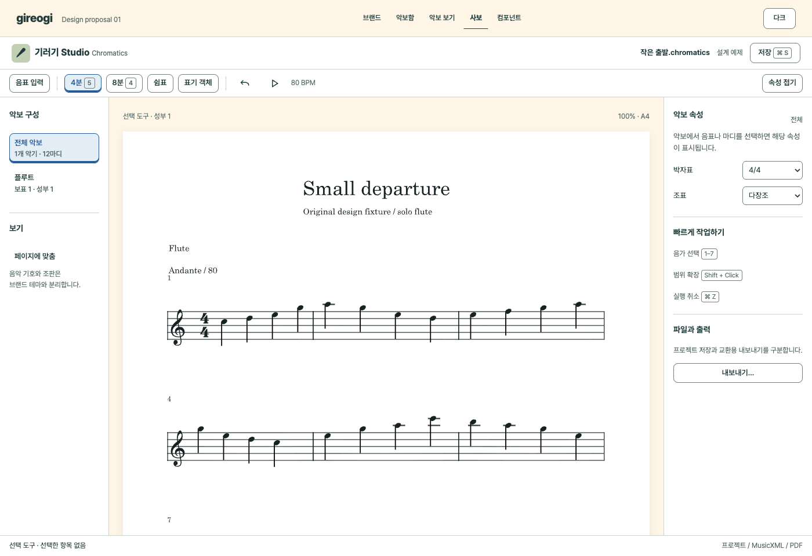
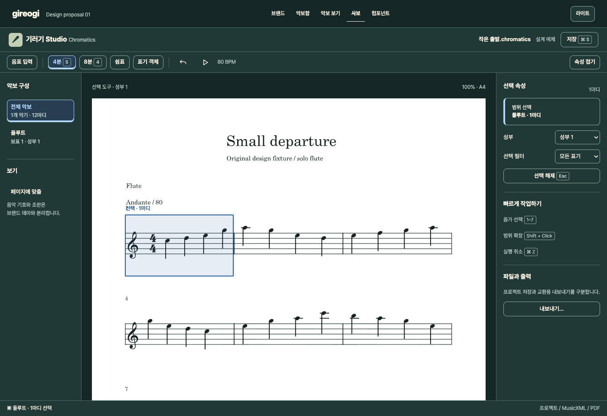
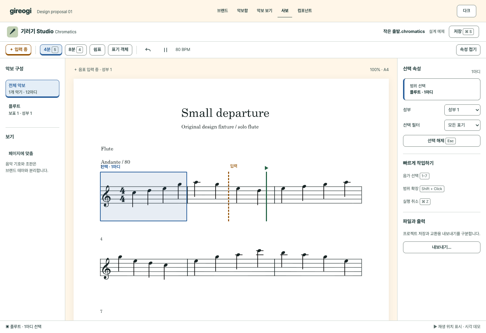

# Chromatics 적용 명세

사보 화면은 음악을 입력하는 도구다. 색채 면적과 장식을 줄이고, 현재 도구·선택 대상·입력 위치·저장 상태를 빠르게 읽을 수 있게 한다. 목업의 `기러기 Studio`는 작업용 이름이다.

## 현재 범위 확인

[App.tsx](../../../src/renderer/src/App.tsx)의 파일/악보/음표/표기 객체/가사/내보내기/재생 분류, 음가·성부·선택·단축키 안내, SpanProperties 연결을 확인했다. [확장 V1 계약](../../product/chromatics-expanded-v1.md)의 필수 작업은 아직 모두 완료되었다는 의미가 아니다. 기존 [단성부 중심 브랜드 문구](../brand-foundation.md)만으로 현재 편집 기능의 범위를 제한하지도 않는다.

목업은 한 악기·12마디의 창작 예제를 사용한다. 실제 프로젝트를 수정하거나 모든 표기 객체의 속성을 구현하지 않았다.

## A 기본 작업 화면

전체 구조는 문서 헤더 → 주 도구 → 구성/캔버스/속성 → 상태줄이다. 같은 헤더 안에 브랜드와 파일명을 두되 브랜드가 문서 제목보다 큰 면적을 차지하지 않게 한다.

| 영역 | 1400px 기준 | 역할 |
| --- | --- | --- |
| 문서 헤더 | 높이 56, 좌우 20 | 제품·파일명·저장 진입점 |
| 도구 | 높이 48 이상, 명령 32, 그룹 간 구분 | 입력 모드·음가·표기·실행 취소·재생 |
| 왼쪽 구성 | 폭 188, 내부 16 | 전체 악보/파트/보기 |
| 악보 캔버스 | 남은 폭, 바깥 24, 내부 스크롤 | 실제 악보와 상태 오버레이 |
| 오른쪽 속성 | 폭 256, 내부 16 | 선택 대상과 속성 |
| 상태줄 | 높이 36 | 현재 모드·선택·저장/재생 결과 |

툴바는 짧은 자주 쓰는 명령을 유지하고, 표기 객체처럼 폭넓은 범주는 펼쳐지는 영역으로 처리한다. 모든 표기·내보내기 형식을 상시 버튼으로 늘어놓지 않는다. 숨긴 명령은 키보드와 메뉴를 통해 다시 찾을 수 있어야 한다. 실제 메뉴 전체 재설계는 제품의 command inventory와 연결한 후 진행한다.

## B 선택과 속성

흐름: 선택 도구 → 악보 객체/마디 선택 → 선택 범위와 대상 이름 확인 → 해당 속성만 표시 → 조절/실행 취소 → 선택 유지 또는 해제. 대상을 선택하지 않았을 때는 전체 악보 속성을 표시하고, 의미 없는 음표 속성을 빈 입력칸으로 나열하지 않는다.

목업의 첫 마디 hit area는 예제 SVG의 마디 위치에 맞춘 고정 비율이다. 실제 앱은 악보 렌더러의 객체·마디 좌표를 사용해야 한다. CSS 비율값을 제품의 hit testing으로 옮기지 않는다. 재생 커서·입력 위치도 시각적인 상태 예제이며 재생 엔진의 시간·음높이를 반영하지 않는다.

| 상태 | 확인할 정보 | 조작 |
| --- | --- | --- |
| 선택 없음 | 현재 모드·보표/성부 | 악보 속성 또는 작업 안내 |
| 단일 객체 | 객체 종류·마디·보표 | 음높이/길이 등 유효한 속성 |
| 범위 | 범위 시작/끝·선택 필터 | 적용 가능한 명령, 공통값/혼합값 구분 |
| 스팬 | 슬러/헤어핀 등의 대상 | 끝점·방향·배치. 실제 계약과 연결 |
| 입력 중 | ＋ 입력 라벨·현재 음가·성부 | 점선 입력 커서. IME/텍스트 필드에서는 사보 단축키 중지 |
| 재생 중 | ▶ 표식·실선 위치 | 선택을 지우지 않고 독립적으로 이동 |

색상은 [컴포넌트 상태표](components.md)의 악보 전용 의미를 쓴다. Note의 하늘색과 Studio의 세이지색은 앱 정체성용이다. 이를 선택색으로 자동 연결하지 않는다. 다크 모드에서도 악보는 흰색이므로 악보 위 상태색은 유지한다.

## 창 크기와 밀도

960px에서는 왼쪽 152, 오른쪽 232, 캔버스 바깥 16을 출발점으로 한다. 속성을 접으면 캔버스가 넓어지고, 다시 열어도 선택을 잃지 않는다. 전체 화면의 가로 스크롤보다 캔버스 내부 스크롤을 우선한다. 작은 창에서 내보내기·저장 등 필수 명령이 사라지지 않아야 한다.

700px 미만의 목업에는 왼쪽 구성을 숨기고 속성을 아래로 배치하는 보조 검토안을 넣었다. 이는 모바일 사보 제품을 새로 제공한다는 결정이 아니다. 핵심 검토 범위는 960/1400px 데스크톱이다. touch 사용을 제품 범위로 넣는다면 32px 명령을 확대하는 별도 적응 레이아웃이 필요하다.

## 키보드와 파일

현재 소스의 단축키 예: 음가 1–7, 타이 T, 슬러 S, 성부 V, 범위 확장 Shift+Click, 저장 Cmd/Ctrl+S, 실행 취소 Cmd/Ctrl+Z. 정확한 제품 명령과 키 매핑은 소스를 기준으로 유지한다. 임의로 Figma의 키를 가져오지 않는다. 목업은 일부 버튼의 상태 전환과 Enter/Escape만 구현했고 전체 편집 단축키를 연결하지 않았다.

프로젝트 저장, MusicXML 교환, PDF 출력은 서로 다른 행동이다. 현재 네이티브 프로젝트의 `.chromatics` 확장자는 [파일 형식 계약](../../product/chromatics-native-project-format.md)을 따른다. ‘내보내기’가 프로젝트의 dirty 상태를 해제했다고 표시하면 안 된다. 저장 중 편집, 저장 실패, 다른 이름으로 저장, 지원하지 않는 형식의 경고는 실제 파일 생명주기 계약과 연결한다. 목업의 저장/내보내기는 해당 차이를 설명하는 대화상자만 연다.

## 후속 제품 검증

여러 보표·성부·이조·파트보·스팬·조판 객체로 속성 패널이 확장되는지 확인한다. 실제 VexFlow 출력의 선·기호·충돌, 인쇄 결과, 편집 후 undo/redo·재열기 정확성은 별도 제품 테스트와 음악적 검수 대상이다. 디자인 시스템 완료가 해당 검증을 대신하지 않는다.
