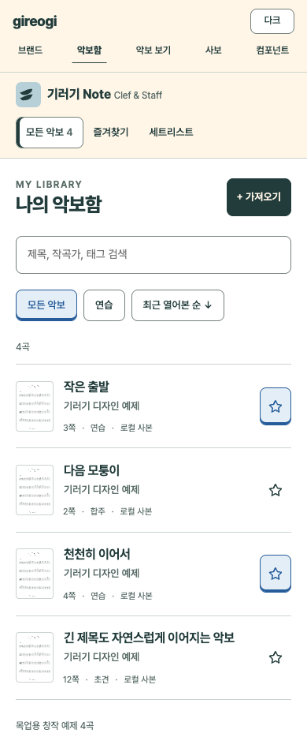
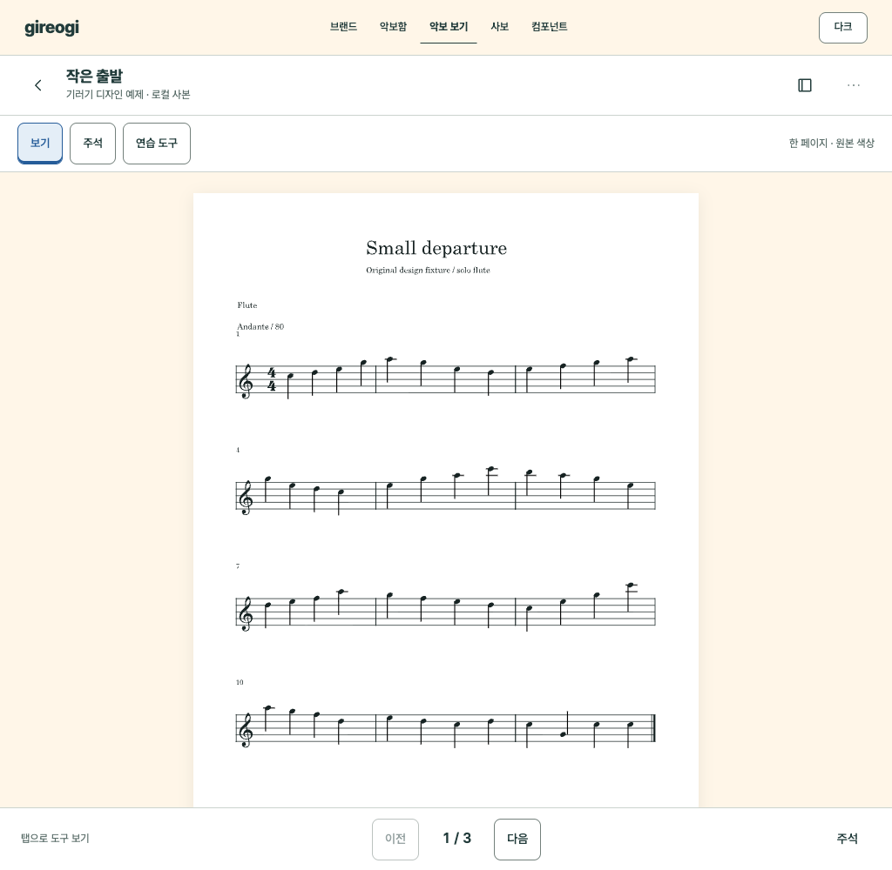
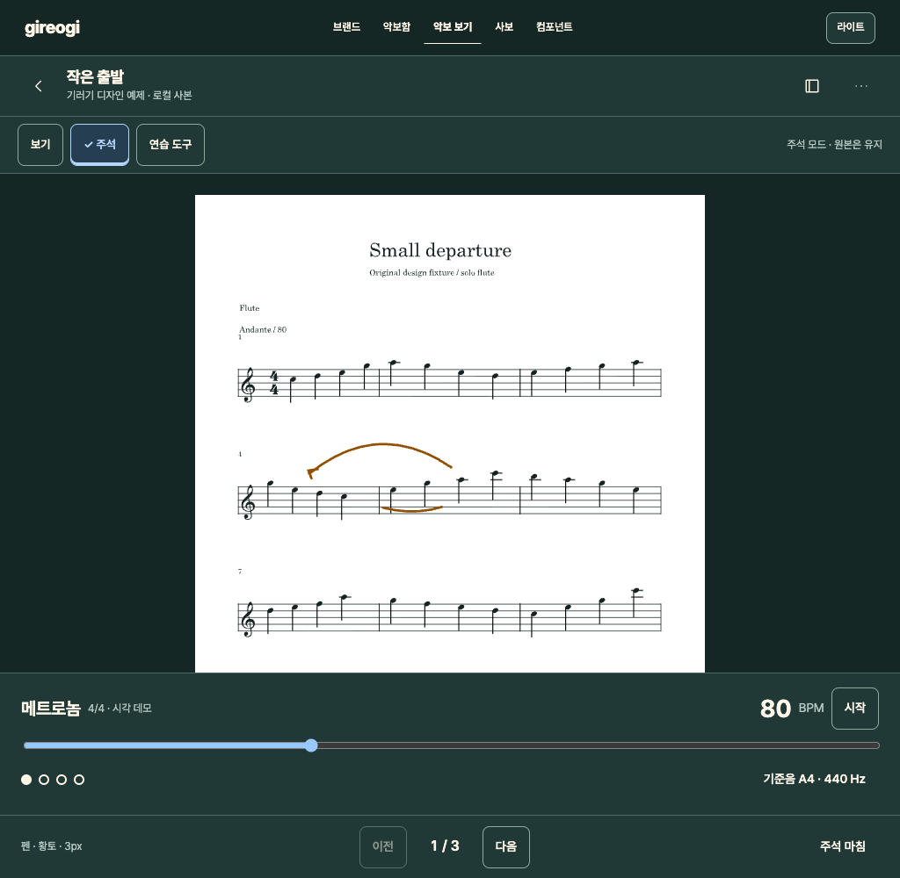

# Clef & Staff 적용 명세

목표는 악보를 빨리 찾고, 연습 중 도구를 쓰더라도 다시 읽던 위치로 돌아오는 것이다. 브랜드는 악보함과 도구의 모양에 드러나고, 악보 원본을 꾸미지 않는다. 목업의 `기러기 Note`는 작업용 제품명이다.

## 현재 기능과 제안

[앱 README](../../../apps/in_c_sheet/README.md), [기능 맵](../../product/sheet-viewer-feature-map.md), [main.dart](../../../apps/in_c_sheet/lib/main.dart)의 SheetLibraryScreen·SheetViewerScreen을 확인했다. 로컬 PDF/이미지 가져오기, 검색·정렬·메타데이터, 세트리스트, 북마크, 주석, 페이지 모드, 메트로놈, 기준음/드론 등의 기존 기능을 대상으로 배치를 설계했다. 태블릿 도구 배치와 연습 도구 통합 패널은 새로운 UI 제안이며 현재 화면을 촬영한 것이 아니다.

실기기 튜너 정확도·S Pen·페달·파일 제공자 접근과 같은 항목은 README의 QA 경계를 유지한다. 디자인 목업에서 성공한 버튼 클릭을 해당 기능의 실제 검증으로 사용하지 않는다.

## A 악보함에서 열기

흐름: 앱 열기 → 나의 악보함 → 검색/필터 → 악보 제목 → 마지막 읽던 위치. 가져오기는 목록보다 위에 있는 명시적인 행동으로 둔다. 추가 옵션이 기본 열기 동작을 가로채지 않게 한다.

| 영역 | 모바일 기준 | 태블릿 기준 |
| --- | --- | --- |
| 브랜드/분류 | 위쪽 1행 브랜드 + 가로 분류 | 왼쪽 약 220dp 탐색 |
| 제목/가져오기 | 좌우 20dp, 제목 25–28sp, 버튼 48dp | 콘텐츠 좌우 28–40dp |
| 검색 | 전체 폭, 높이 48dp, 한 줄 라벨 | 동일 의미, 넓은 검색 필드 |
| 목록 | 썸네일 48×64, 제목 16, 부가정보 12–13 | 썸네일 64×78, 제목 18 |
| 보조 행동 | 즐겨찾기와 옵션은 별도 hit area | 필요하면 추가 열로 확장 |

모바일은 카드 격자보다 제목이 읽히는 목록을 기본으로 제안한다. 긴 제목은 필요한 만큼 줄바꿈하고, 작곡가·쪽수·분류의 우선순위를 지킨다. 로컬 사본·파일 누락·가져오기 실패는 서로 다른 상태다. 클라우드에 백업된 것처럼 보이는 기호를 기본으로 붙이지 않는다.

검색 결과 없음에서는 기러기를 작게 쓰고 검색어·필터를 바꿀 수 있게 한다. 목업의 네 곡은 직접 만든 디자인 예제 데이터이며 사용자 라이브러리 수치가 아니다.

## B 악보 열람과 연습

상단은 돌아가기·제목·북마크/옵션, 두 번째 줄은 보기/주석/연습 도구다. 하단은 페이지 이동을 고정한다. 주석·연습 패널이 악보 위를 덮지 않도록 별도 레이아웃 영역을 사용한다. 좁은 화면에서는 추가 도구를 overflow로 정리하고 핵심 이전/다음은 유지한다.

상단 두 줄을 항상 고정하라는 뜻은 아니다. 평소 열람에서 자동 숨김을 유지할 수 있지만, 다시 나타내는 방법과 공연 중 잠금 해제는 예측 가능해야 한다. 목업은 위치를 비교하기 위해 고정 표시했다.

| 모드 | 화면 표시 | 입력 해석 | 나가는 방법 |
| --- | --- | --- | --- |
| 보기 | ‘보기’ 선택, 원본 색상 | 페이지 이동·확대·툴바 표시 | 주석/연습 도구 선택 |
| 주석 | ‘주석’ 선택 + 펜·색·두께 요약 | 주석 입력. 페이지 넘김 제스처와 충돌 방지 | ‘주석 마침’, 기존 하드웨어 정책 유지 |
| 연습 도구 | 악보 아래 별도 패널 | 메트로놈·기준음 도구 조작 | 같은 버튼으로 닫고 악보 anchor 유지 |
| 공연 | 브랜드 장식 숨김, 잠금 상태 명시 | 실수로 편집에 들어가지 않도록 보호 | 명확한 잠금 해제. 구체 동작은 실기기 검증 후 결정 |

주석에서는 원본 파일이 바뀌는지 사본/메타데이터가 바뀌는지 정확하게 안내한다. 목업의 펜 선은 정적인 상태 예제이며 필압·좌표 정합·저장 품질을 증명하지 않는다.

메트로놈은 BPM·박자·시작/정지가 첫 계층, 세부 설정은 다음 계층이다. Click/Chime을 별도 앱으로 이동시키지 않는다. 기준음은 주파수·기준 음을 확인한 뒤 사용자가 시작한다. 브랜드 시작음과 섞지 않는다. 목업에서는 BPM 값과 시각 상태만 변하고 소리는 나지 않는다.

## 악보와 다크 모드

앱 배경·패널만 다크로 전환한다. PDF/이미지는 원본 색상과 흰 페이지를 유지한다. 반전·대비 효과는 별도의 사용자가 선택한 문서 표시 설정으로 취급하고, 자동 테마와 연결하지 않는다. 원본과 출력물의 색은 표시 효과 때문에 바뀌지 않아야 한다.

정적 예제 악보는 760×1040 SVG이며 읽기 목업에서는 태블릿 최대 폭 580px로 표시했다. 실제 앱의 fit page/fit width, 가로 2페이지, 반 페이지 모드에 이를 강제로 적용하지 않는다. 가로 태블릿에서 도구와 페이지가 어떻게 나뉘는지 별도 구현 검토가 필요하다.

## 접근성과 후속 검증

- 핵심 명령 48dp 기본, 실제 글자 크기 확대 시 줄바꿈과 툴바 넘침 확인.
- 페이지 이동 버튼은 현재/전체 쪽수와 함께 제공. 문서 순서·숨긴 페이지가 있으면 표시 쪽수와 원본 쪽수를 구분.
- 스와이프 외 버튼·키/페달의 대안 제공. 페달의 정확한 키 매핑은 장비 확인 전 확정하지 않음.
- 주석과 보기 모드의 상태를 보조기술로 전달하고, 스타일러스 입력 후 손바닥·터치 처리와 실제 충돌을 확인.
- 연습 패널 열기/닫기와 회전 후 같은 악보 위치 복귀, 지연 없는 페이지 이동을 실기기로 확인.
- 실기기 최대 밝기·어두운 합주실·무대에서 대비와 눈부심을 검토.

원본 렌더링·주석·하드웨어 입력은 Flutter 제품에서 검증해야 한다. 이번 산출물은 레이아웃과 상태 규칙의 적용 기준이다.
