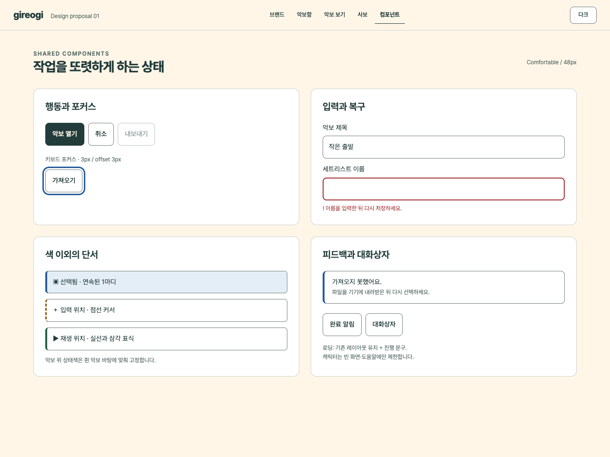

# 공통 컴포넌트와 상태

브랜드는 컨트롤의 모서리와 위계에 드러나고, 상태는 행동의 결과를 설명한다. 사용자에게 보이는 문장은 한국어를 우선하며 ‘실패한 행동 + 다음 방법’을 함께 제시한다.

## 크기와 상태 계약

| 컴포넌트 | 구조·크기 | 기본·hover·focus | 선택·처리 중·비활성·오류 |
| --- | --- | --- | --- |
| 주요/보조 버튼 | 높이 48/32, 좌우 14/10, radius 8 | 주요 action/onAction, 보조 surface/controlBorder. hover는 경계 강화, focus는 바깥 3px | 처리 중은 라벨과 폭 유지, 중복 실행 방지. disabled .48 + disabled 속성 |
| 아이콘 버튼 | 내부 기호 20, hit area 48/32 | 라벨·tooltip·기능이 일치 | toggle은 aria-pressed 또는 동등 Semantics. 색 + 아래 경계 등 형태 |
| 입력·검색 | 높이 48/32, 항상 접근 가능한 라벨 | placeholder만으로 이름을 대신하지 않음 | 오류 2px 경계·!·문구, aria-invalid/describedby. 입력값 보존 |
| 필터·세그먼트 | 최소 간격 8, 같은 그룹 높이 통일 | 키보드/포인터 모두 작동 | 독립 toggle은 pressed, 단일 선택은 일관된 단일 선택 모델 |
| 탭·내비게이션 | 최소 32, 터치 핵심은 48 | 현재 위치를 굵기·밑줄로 표시 | 페이지 이동은 aria-current, 진짜 탭 패널은 tab/tabpanel·화살표 키 구현 |
| 메뉴 | 항목 48/32, 메뉴 최소 여백 8 | anchor 주변에 열고 화면 밖으로 나가지 않음 | 위/아래·Home/End, Escape 닫기·트리거 복귀. 해당 없는 명령은 이유 제공 |
| 툴팁 | 짧은 기능명 + 실제 단축키 | hover와 focus 모두, Escape로 해제 | 필수 정보·복구 행동을 tooltip에만 넣지 않음 |
| 툴바 | 높이 48 이상, 그룹 사이 16 | 기능별 그룹과 단축키 안내 | 입력 모드를 상시 표시. 손가락 환경에는 도구 수를 줄이고 영역 확대 |
| 패널 | 내부 16, section 간 24, radius 12 또는 도킹 직선 경계 | 제목·선택 대상·닫기 관계 명확 | 접어도 선택은 유지, 다시 열 때 마지막 위치 복원 |
| 목록 | 행 64/36 이상, 항목 간 경계 | 제목 우선, 부가정보는 12/13 | 선택 경계 + 상태. 긴 제목은 2줄 또는 ellipsis+전체 이름 접근 |
| 소비자 카드 | padding 16/24, radius 16 | 클릭 가능한 영역 명확 | 광고·파일 누락 같은 의미는 배지와 문구로 명시 |
| 대화상자 | 폭 320–480, padding 24, 주요 행동 하단 | 열릴 때 제목/첫 적절한 요소로 이동 | modal focus containment, Escape·취소, 트리거로 focus 복귀 |
| 알림 | 짧은 결과 + 필요한 복구 | 보통 live polite, 작업을 가리지 않는 위치 | 중요한 실패는 자동 사라짐에 의존하지 않음. 중단된 저장은 지속 메시지 |

선택할 수 없는 요소를 모두 숨기지는 않는다. 현재 작업과 무관한 명령은 정리하고, 기능 발견이 필요한 disabled 명령에는 해제 조건을 제공한다. native tooltip/title은 목업의 축약 표현이며 실제 터치·보조기술 tooltip의 완성 구현은 아니다.

## 악보 상태 구분

| 상태 | 색 | 형태·텍스트 | 동시 존재 시 |
| --- | --- | --- | --- |
| 선택 | scoreSelection | 범위 테두리/얇은 면 + ‘선택 · 1마디’ | 재생 커서가 위를 지나도 선택 경계 유지 |
| 입력 | scoreInput | 점선 수직선 + ＋/‘입력’ + 도구 pressed | 포커스·선택과 별개. 입력 종료를 Escape로 제공 |
| 재생 | scorePlayback | 실선 수직선 + ▶ | 선택을 이동시키지 않고 현재 위치만 표시 |
| 키보드 포커스 | focus | 컴포넌트 밖 3px 실선 | 음악 객체 선택과 분리. 화면 가장자리에서도 잘리지 않음 |
| 오류 | scoreError/error | ! + 구체적 문장 | 입력을 삭제하지 않고 복구 경로 제시 |
| 주석 | 사용자 선택 잉크 | 별도 주석 모드·펜 표식 | 문서 선택색·진행 커서와 같은 의미로 사용하지 않음 |

색각 차이가 있어도 경계의 실선/점선, 표식, 문구로 구분하도록 설계했다. 시뮬레이션이나 사용자 관찰 없이 식별률이 검증되었다고 쓰지 않는다.

## 터치와 키보드

악보앱의 핵심 컨트롤은 48dp를 기본으로 한다. 실제 목업의 모바일 보기/주석 버튼은 최소 44px 높이와 48px 폭을 확보했다. 데스크톱은 32px를 기본으로 한다. 이는 우리 설계 목표이며 [WCAG 2.5.8의 24 CSS px 기준과 예외](https://www.w3.org/WAI/WCAG22/Understanding/target-size-minimum.html)와 같은 수치라고 표현하지 않는다.

모든 실제 명령에 접근 가능한 이름을 제공한다. toggle은 상태를 읽어 주고, 단순 페이지 링크를 tab 역할로 위장하지 않는다. 패널 변경 후 focus를 잃지 않게 한다. 시스템 파일 대화상자·앱 전환 후에는 원래 동선으로 복귀한다. 메뉴/전체 사보 캔버스의 키보드 모델은 제품 구현에서 별도 검증한다.

드래그 전용 작업에는 ‘위/아래로 이동’, 위치 입력, 키보드 조정 같은 대안을 둔다. 페이지 넘김은 스와이프 외 이전/다음 버튼을 제공한다. 속성 패널 도킹·폭 조절을 실제로 구현할 때는 방향키·메뉴 대안과 저장/초기화를 함께 제공한다. 목업은 접기만 구현했다.

## 빈 화면과 실패

| 상태 | 보여줄 내용 | 행동 |
| --- | --- | --- |
| 첫 악보함 | 작은 기러기 + ‘첫 악보를 가져오세요’ | PDF/이미지 가져오기 |
| 검색 결과 없음 | ‘찾는 악보가 없어요’ + 검색 범위 | 검색어 줄이기/필터 해제 |
| 로딩 | 기존 제목·영역 유지 + ‘악보를 여는 중…’ | 장시간이면 취소/다시 시도. 가짜 진행률 금지 |
| 파일 없음 | 파일명 + 접근 실패 이유 | 기기에 내려받기/다시 선택 |
| 저장 실패 | 저장되지 않은 변경이 있음을 유지 | 다른 위치/다시 저장. 성공 알림 금지 |
| 권한 거절 | 필요한 기능과 권한을 연결해 설명 | 해당 기능을 쓰지 않고 계속/설정 안내 |

목업에는 검색 빈 화면, 입력 오류, 복구 문구, 완료 알림, modal dialog가 있다. 파일 시스템·마이크·PDF 렌더링 실패는 문구와 상태 계약이며 실제 장애를 재현하지 않았다.

## 모션과 피드백

직접 누른 행동에 대한 시각 피드백을 우선한다. 저장·페이지 이동·악보 입력에 브랜드 사운드를 자동 재생하지 않는다. 캐릭터가 클릭한 명령을 가로막지 않게 하고, 도움말은 작업을 중단하지 않아도 읽을 수 있어야 한다. reduced motion·무음 상태에서도 결과를 이해할 수 있어야 한다.
