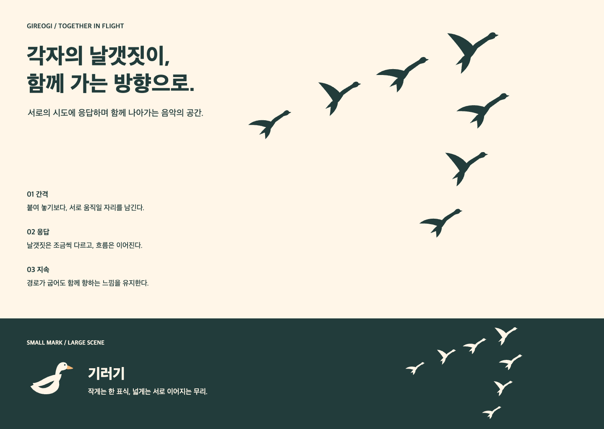

# 기러기 떼와 비행 그래픽

모브랜드의 대표 장면은 서로 간격을 두고 함께 날아가는 기러기 떼다. 각자의 시도가 다른 사람에게 닿고, 그 응답이 다음 움직임을 만든다는 서비스의 의미를 담는다. 『기러기의 선물』에서 출발한 격려와 응답을 제품군 전체의 시각적 중심으로 확장한다.

## 세 가지 표현 크기

| 층위 | 표현 | 사용하는 자리 |
| --- | --- | --- |
| 대표 장면 | 여러 기러기의 비행과 그 사이의 여백 | 브랜드 소개, 랜딩 상단, 공연·커뮤니티 캠페인, 넓은 표지 |
| 작은 식별 표식 | 단일 기러기 심벌 + 워드마크 | 작은 헤더, 앱군 안내, 브랜드 서명 |
| 제품 식별 | 날개·겹깃·깃대·머리 쌍·대칭 날개 | 앱 아이콘과 제품별 헤더 |

‘함께’는 무리를 이루는 장면에서 전달하고, 작은 아이콘은 빠르게 읽히는 형태로 축약한다. 모든 런처 아이콘에 기러기 여러 마리를 넣지 않는다. 전문 작업 화면은 현재의 집중도와 밀도를 유지한다.

## 비행 실루엣

[날개를 올린 포즈](assets/flight-rise.svg)와 [날개를 펼친 포즈](assets/flight-glide.svg)를 만들었다. 긴 목, 작은 머리, 뒤로 흐르는 몸과 꼬리, 넓은 날개의 면을 사용한다. 두 포즈를 섞어 개체마다 움직임이 조금씩 다르게 느껴지도록 한다. 포즈는 브랜드 일러스트이며 비행 역학을 설명하는 도해가 아니다.

일반적인 작은 V 표시만 반복하면 기러기라는 인상이 약해질 수 있다. 큰 그래픽에는 목과 몸이 읽히는 실루엣을 사용한다. 아주 작은 공간은 원래의 심벌 또는 축약된 세 마리 구성으로 옮긴다. 현재 제공한 기본 장면은 일곱 마리다.

편집 가능한 [Light](assets/flock-light.svg)와 [Dark](assets/flock-dark.svg)는 배경이 투명하고 각각 Ink/Cream 면을 사용한다. 개체는 SVG의 별도 그룹이라 위치·크기·포즈를 바꿀 수 있다. 제품별 파스텔을 각 새에 일대일로 배정하지 않는다. 무리는 음악가·청자·서로의 시도라는 관계를 표현한다.

## 무리의 구성 규칙

1. 세 마리 이상을 기본으로, 넓은 대표 장면은 다섯에서 일곱 마리로 구성한다.
2. 날개가 겹쳐 하나의 덩어리가 되지 않도록 각 개체 주변에 여백을 남긴다. 작은 화면에서는 수를 줄이거나 전체 크기를 조정한다.
3. 방향은 이어지되 위치·크기·포즈는 조금씩 다르게 둔다. 같은 새를 일정 간격으로 복제한 벽지처럼 만들지 않는다.
4. V 형태를 시작점으로 삼되 항상 대칭을 강제하지 않는다. 유연한 경로에서도 무리의 흐름이 읽히면 된다.
5. 특정 개체를 항상 크거나 밝게 그려 영구적인 주인공으로 고정하지 않는다. 화면의 중심은 함께 이동하는 장면이다.

앞서 논의한 ‘장애물을 만나도 방향을 따라 계속 나아감’은 경로의 완만한 굽이와 재정렬로 표현할 수 있다. 소개 화면에서 사용자의 실제 버튼이나 콘텐츠를 장애물로 만들어 새들이 피하게 하지는 않는다.

## 모션 규칙과 현재 목업

브랜드 소개의 기러기 떼는 왼쪽 아래에서 살짝 굽어 제자리로 들어온다. 1800ms 한 번만 재생하고 정지한다. 짧은 컨트롤 전환용 120–240ms와 구분되는 소개 장면 전용 시간이다. 사용자가 ‘비행 다시 보기’를 눌렀을 때만 다시 시작한다.

현재 목업은 두 가지 정적 포즈와 무리 전체의 진입 모션이다. 각 날개의 연속 애니메이션이나 자연스러운 군집 시뮬레이션은 구현하지 않았다. 향후 개별 움직임을 만들 때에도 과도한 날갯짓·동시 점멸·끝없는 회전을 피하고 개체 간 간격을 유지한다.

움직임 줄이기 설정에서는 처음부터 정적인 완성 장면을 보여주며 재생 버튼을 숨긴다. 정보와 의미는 정지 이미지에서도 전달한다. 소리와 햅틱은 자동으로 재생하지 않는다.

| 표면 | 정적 그래픽 | 모션 |
| --- | --- | --- |
| 브랜드 소개·캠페인 | 무리 전체 | 처음 한 번, 필요할 때 사용자가 재생 |
| 공연/커뮤니티 표지 | 넓은 흐름, 필요하면 일부 크롭 | 기본 정적. 콘텐츠 읽기·스크롤을 방해하지 않음 |
| 빈 화면·도움말 | 작은 무리 또는 단일 표식 | 기본 정적 |
| 악보 열람·주석·사보 캔버스 | 작업 영역에는 배치하지 않음 | 비행 모션 없음 |
| 진행률·오류·저장 | 일반적인 정확한 상태 표시 | 기러기 비행으로 상태를 대신하지 않음 |

## 검토 기준

목과 몸이 있는 실루엣이 기러기로 읽히는지, V 구성의 방향이 자연스러운지, 모바일에서 개체가 너무 작아지지 않는지 확인한다. 무리의 관계가 브랜드의 중심으로 느껴지는지는 사용자 관찰로 확인한다. 생물학적 효과나 특정 조직 구조가 증명되었다는 표현은 사용하지 않는다.
