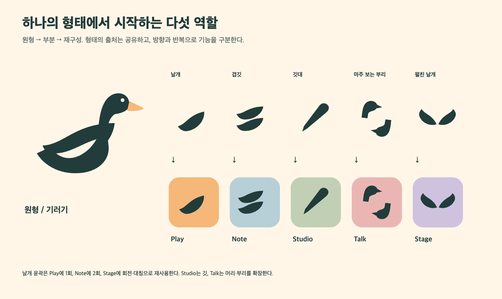
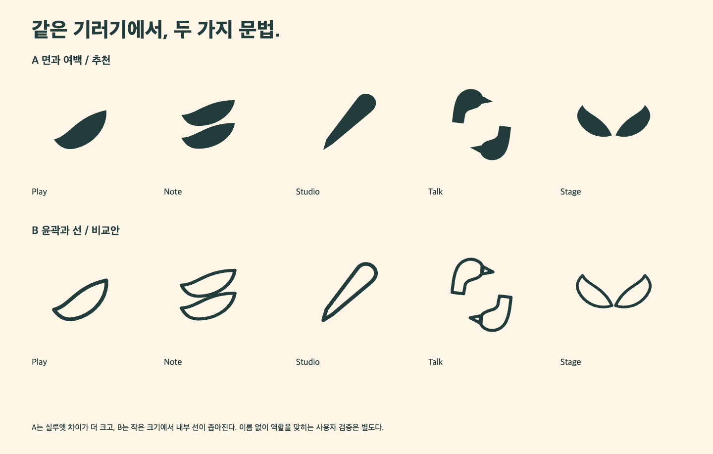
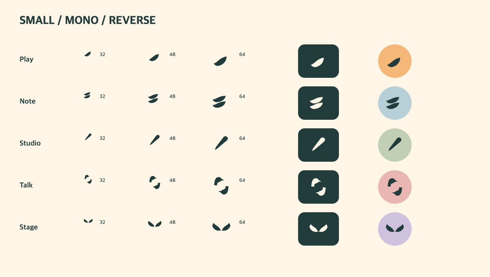

# 기러기 형태와 아이콘

원형은 오른쪽을 향한 기러기다. 긴 목, 낮은 몸, 둥근 머리, 짧은 부리, 몸 안의 날개 여백으로 읽힌다. 앱별 심벌은 해부학적 도감의 정확한 잘라내기가 아니라 이 원형을 설명 가능한 규칙으로 재구성한 추상형이다.

이 원형은 작은 식별 표식이다. 브랜드의 넓은 대표 장면은 [기러기 떼의 비행](flock-and-motion.md)으로 확장한다. 앱 아이콘은 부분 형태를 유지하고, 무리의 관계는 소개·캠페인 그래픽에서 드러낸다.

## 추천 계열 A

| 가칭 | 형태와 조작 | 기능과의 관계 | 혼동 위험과 대응 |
| --- | --- | --- | --- |
| Play | 한 장의 날개, 앞쪽으로 12° 기울임 | 음악을 따라 움직이는 방향 | 잎·물결로 보일 수 있음. 이름을 병기하고 일반 재생 버튼과 혼용하지 않음 |
| Note | 같은 날개를 세로로 두 번 반복 | 악보 페이지와 층위 | 음료·겹친 잎 연상 가능. Studio와는 수평 두 겹/대각선 한 깃으로 구분 |
| Studio | 길게 뻗은 깃대, 25° 회전 | 정밀한 작성과 수정 | 일반 펜과 가까움. 기러기의 깃이라는 파생 관계는 설명 자산으로 보강 |
| Talk | 머리·부리의 짝을 180° 회전 | 말하기와 응답의 왕복 | 두 마리 형태가 작은 크기에서 분리됨. 32px 최소 틈과 목 단면을 확인 |
| Stage | 날개를 회전·좌우 대칭해 중심을 엶 | 무대와 관객을 향한 펼침 | 첫 탐색에서는 두 날개가 겹쳐 종 모양이 됨. 중심을 벌려 실루엣을 수정 |

아이콘이 이름 없이 기능을 완전히 설명한다고 가정하지 않는다. 런처에는 제품명을 병기하고, 앱 안의 페이지 넘김·검색·주석 등은 관습적인 기능 아이콘을 사용한다.

## 두 계열 판단

A는 채운 면과 빈 공간으로 이루어져 역상과 작은 크기에 유리하다. B는 같은 윤곽을 9/256 단위 선으로 그려 가볍지만, 겹치는 깃과 두 날개의 내부 선이 좁아진다. **A를 제품 아이콘의 기준, B를 비교 기록으로 남긴다.** B를 별도의 전문 제품 테마로 운영하지 않는다. 역할 식별률은 아직 사용자 실험으로 측정하지 않았다.

## 수치와 광학 보정

- 마스터: 256×256. 플랫폼 마스크 이전의 투명 심벌 원본을 유지한다.
- 주요 윤곽은 대략 x=24…232, y=32…216 범위 안에 놓고, 원형 마스크에서는 중심·끝부분의 실제 잘림을 확인한다. 같은 바운딩 박스를 채우는 것보다 시각적인 무게를 맞춘다.
- 타일 시안: 곡률 56/256. 이는 리뷰용 외형이며 iOS 마스크를 PNG에 미리 굽는 규칙이 아니다.
- 직선 끝을 과도하게 뾰족하게 만들지 않는다. 단색에서 남는 최소 내부 틈은 16/256 정도를 목표로 하며, 32px에서 약 2px로 보이는지 확인한다. 모든 곡선 구간의 최소 간격이 수학적으로 보증된 것은 아니다.
- 기본 심벌은 Ink. 타일에는 제품 보조색을 사용한다. 역상은 Ink 면 위 Cream. 작은 심벌에서 부리의 Apricot은 식별 필수 정보로 쓰지 않는다.
- 부모 심벌보다 앱 심벌이 시각적으로 작으면 먼저 위치·면적을 조정한다. 플랫폼별 보정을 원본 파괴나 임의의 비균등 확대 없이 별도 변형으로 기록한다.

현재 원형/둥근 사각형은 마스크 검토 예시다. 출시 전 iOS의 현행 아이콘 형식·변형, Android adaptive foreground/background·monochrome, 데스크톱 파일 형식은 공식 플랫폼 요구사항에 맞춰 별도로 제작한다. 이번 SVG/PNG를 검증된 스토어 자산으로 취급하지 않는다.

## 워드마크

[편집 가능한 SVG](assets/wordmark.svg)는 심벌 왼쪽, 한글 위, 영문 아래의 조합이다. 한글 800, 영문 650을 출발점으로 사용하고 한글의 시각적 크기가 앞선다. 작은 앱 헤더에서는 한글/영문을 모두 쌓지 않고 `기러기 Note`처럼 한 줄로 쓴다. 영문 단독 표기는 소문자 `gireogi`를 사용한다.

보호 공간은 심벌 머리 높이를 기준으로 약 16/256 이상 둔다. 120px보다 좁은 잠금 조합에서는 영문을 빼거나 심벌 단독으로 전환한다. 최종 로고 확정 시 레터링과 축소 한계는 다시 검토한다. SVG 텍스트는 Pretendard가 설치되어 있어야 같은 모양으로 편집된다.

## 캐릭터와 그래픽

강도는 0=작업 화면 없음, 1=빈 화면/도움말, 2=행사·커뮤니티 일러스트로 정의한다. 악보·주석·선택 영역·재생 타임라인에는 0을 적용한다. 라이브러리 빈 화면은 1, Talk·Stage 캠페인은 2까지 가능하다.

캐릭터는 눈·부리·날개의 최소 단서만 사용하고 옷·직업·앱별 성격을 부여하지 않는다. 반복되는 실패에 울거나 꾸짖는 표정을 사용하지 않는다. 작업 UI에서는 빈 검색 결과의 정적인 기러기를 사용한다. 브랜드 소개는 별도의 무리 비행 그래픽을 사용한다. 표정·의상 중심 캐릭터 포즈 세트는 포함하지 않는다.

날개 부분은 포스터의 넓은 면·방향 패턴으로 확장할 수 있다. UI 배경 전체를 무늬로 채우거나 악보 위에 그래픽을 얹지 않는다.
