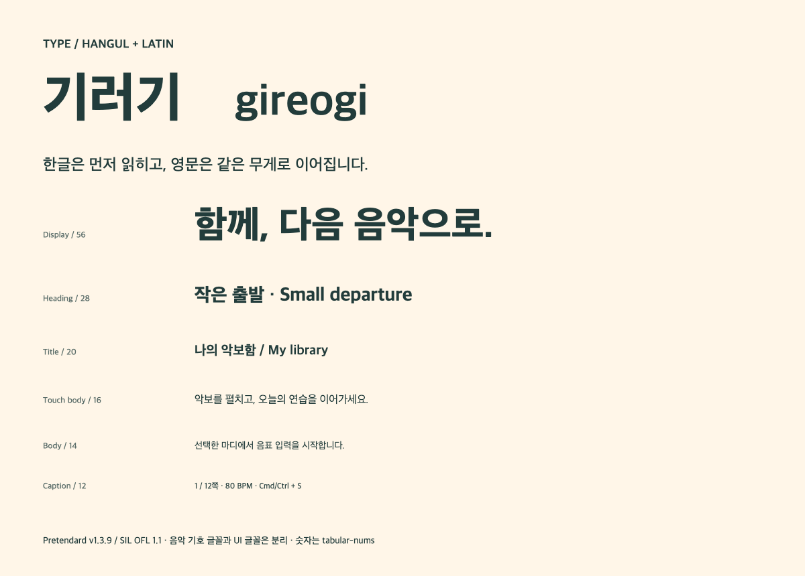

# 토큰과 타이포그래피

[tokens.json](tokens.json)이 값과 별칭의 원본이다. 순서는 기본값 → 의미 → 컴포넌트다. 제품 구분과 화면 상태를 분리하고, 테마와 밀도를 독립적인 축으로 둔다.

## 모드와 단위

이 JSON은 프로젝트 제안 형식이며 특정 디자인 도구의 무변환 import를 보장하지 않는다. `$type`, `$value`와 `{경로}` 별칭을 사용한다. `$mode`는 light/dark, `$density`는 comfortable/compact로 치환한 뒤 별칭을 해석한다. dimension은 논리적인 px/dp, duration은 ms다. CSS에서는 px를 붙이고 Flutter에서는 double logical pixel로 변환한다. 모바일의 사용자 글자 크기 설정을 고정 px로 막지 않는다.

```text
primitive.color.ink                    #223C3B
semantic.light.action                 {primitive.color.ink}
semantic.dark.action                  {primitive.color.apricot}
component.button.background           {semantic.$mode.action}
component.button.height               {density.$density.controlHeight}
```

`preview/tokens.css`는 생성 파일이다. 색이나 높이를 바꾸려면 JSON 생성 원본인 `tools/build.py`를 수정하고 재생성한다. JSON을 다른 도구에서 직접 편집했다면 생성 스크립트와 먼저 동기화한다. 두 파일을 독립적으로 운영하지 않는다.

## 색상 역할

| 의미 | Light | Dark | 사용 |
| --- | --- | --- | --- |
| background | #FFF6E8 | #142725 | 작업 영역 바깥·앱 배경 |
| surface | #FFFFFF | #203936 | 목록·패널·컨트롤 |
| raised | #FFFFFF | #2B4541 | 겹쳐 열린 면 |
| text | #223C3B | #FFF6E8 | 본문·아이콘 |
| muted | #596C68 | #B4C6C0 | 보조 설명, 사용 가능한 보조 텍스트 |
| border | #CBD3CE | #4F6963 | 장식적인 섹션 구분선 |
| controlBorder | #74817C | #90AAA0 | 입력이나 버튼을 식별하는 경계 |
| action / onAction | Ink / Cream | Apricot / Ink | 주요 행동 |
| focus, selection | #255C99 | #B4D6FF | 포커스와 선택. 형상으로 둘을 구분 |
| selectionFill | #E4EEF7 | #253E52 | 선택 표면 |
| input | #935000 | #FFD096 | 입력 중인 UI 상태 |
| playback, success | #216143 | #A6DFBA | 재생과 완료. 문구·표식으로 구분 |
| error | #A33135 | #FFB4B4 | 실패·파괴적 행동 |

border는 약한 구분선으로, 컨트롤의 유일한 식별 경계로 사용하지 않는다. controlBorder는 별도 대비 기준을 충족하도록 진하게 뒀다. 비활성 컨트롤은 불투명도 .48을 출발점으로 하되 중요한 상태 설명까지 흐리게 만들지 않는다.

브랜드의 Apricot에 흰 본문을 올리지 않는다. 측정 결과는 [대비 기록](evidence/validation.json)의 brand 행에서 확인할 수 있다. 제품 보조색은 런처 아이콘·작은 제품 라벨에 사용하고 선택/오류/저장 상태를 대신하지 않는다.

### 악보 위 상태

scorePaper=#FFFFFF, scoreInk=#223C3B는 두 모드에 공통이다. 예제 악보 자체는 중립적인 #172323 잉크로 생성했다. 실제 PDF의 잉크를 scoreInk로 다시 칠하라는 의미는 아니다.

scoreSelection=#255C99, scoreInput=#935000, scorePlayback=#216143, scoreError=#A33135도 모드에 따라 밝게 뒤집지 않는다. 흰 악보 위에 다크 UI용 밝은 파랑을 그대로 올리면 경계가 사라지기 때문이다. UI 팔레트와 악보 오버레이 팔레트는 대응되는 의미를 갖되 별도의 사용 맥락이다.

## 간격과 형태

| 범주 | 기준 |
| --- | --- |
| 간격 | 0, 2, 4, 8, 12, 16, 24, 32, 48, 64 |
| 컨트롤 / 패널 / 소비자 카드 곡률 | 8 / 12 / 16 |
| 아이콘 버튼 내부 기호 | 기본 20 또는 24. 누르는 영역과 분리 |
| comfortable | 컨트롤 48, 행 64, 묶음 간격 12 |
| compact | 컨트롤 32, 행 36, 묶음 간격 8 |
| focus-visible | 3px 실선, offset 3px. 클리핑과 인접 겹침 확인 |
| 기본 패널 그림자 | 0 8px 24px, Ink 계열 10% |

compact는 포인터·키보드 중심 작업 공간이다. touch 장치에 32dp 컨트롤을 일괄 적용하지 않는다. 작은 창이라고 compact로 자동 전환하지도 않는다. 컨트롤 내부 기호는 같아도 터치용 hit area를 확장한다.

## 타이포그래피



UI 기본 후보는 Pretendard v1.3.9다. 공식 배포의 [SIL OFL 1.1](https://github.com/orioncactus/pretendard/blob/v1.3.9/LICENSE)을 확인하고, [폰트 파일과 라이선스](assets/fonts/)를 함께 보관했다. 한글과 영문을 지원하는 본 배포를 사용하며 한글이 빠진 Pretendard Std와 혼동하지 않는다.

| 용도 | 크기 / 행간 | 무게 |
| --- | --- | --- |
| 캠페인 display | 56 / 약 1.16 | 750–800 |
| 화면 제목 | 28 / 1.25 | 750 |
| 패널·카드 제목 | 20 / 1.35 | 650 |
| 터치 본문 | 16 / 1.55 | 400–500 |
| 데스크톱 본문 | 14 / 1.55 | 400–500 |
| 도구 라벨 | 13 / 1.4 | 550–650 |
| 부가 정보 | 12 / 1.5 | 400–500 |

워드마크 한글 800·영문 650은 시각적인 무게 조정이다. UI 본문을 워드마크 굵기로 쓰지 않는다. 숫자/BPM/페이지는 tabular-nums를 사용하고 단축키는 작은 키캡으로 분리한다. Windows에서는 Cmd 대신 Ctrl을 표시한다. 목업의 ⌘는 macOS 예시다.

웹 fallback은 Apple SD Gothic Neo → Noto Sans KR → system-ui다. 실제 글꼴이 없을 때 줄바꿈·폭이 달라질 수 있으므로 내장 폰트를 기준으로 검토한다. Flutter에서는 번들 등록과 FontWeight 매핑을 별도 적용한다. 악보 기호는 현재 렌더러·PDF에 맡기고 UI 글꼴로 대체하지 않는다.

## 모션과 소리

모션은 quick 120ms, normal 180ms, slow 240ms, easing `cubic-bezier(0.2,0,0,1)`를 출발점으로 한다. hover·선택은 quick, 패널은 normal, 비핵심 설명은 slow까지 허용한다. 페이지 넘김의 핵심은 입력 응답과 위치 안정성이다. 넘기는 종이 애니메이션을 기본값으로 추가하지 않는다.

브랜드 소개의 [무리 비행](flock-and-motion.md)은 별도 장면으로 1800ms 한 번 재생한다. 컨트롤의 응답 시간을 길게 늘리는 토큰으로 사용하지 않는다. 움직임 줄이기에서는 정적 그래픽을 보여준다.

움직임 줄이기에서는 비필수 전환을 0ms로 하고, 메트로놈은 선택 가능한 고정 박자 표식/숫자를 제공한다. 사운드 로고는 상향하는 짧은 두 음 정도의 탐색 방향만 제안한다. 앱 실행·저장·페이지 이동에는 기본적으로 소리를 넣지 않는다. 연습 음원·기준음과 브랜드 소리를 섞지 않는다. 햅틱은 직접 누른 확인에 제한하고, 박자 햅틱은 명시적 선택 기능으로 검토한다. 실제 음원과 햅틱은 이번에 제작·기기 검증하지 않았다.

## 플랫폼 대응 예시

CSS는 `--g-background`, `--g-surface`, `--g-text`, `--g-action`, `--g-focus` 등 의미 토큰을 사용한다. `--inc-*`를 곧바로 전역 치환하지 말고 [이행표](migration.md)에 따라 실제 의미를 확인한다.

Flutter 대응은 다음 구조로 구현할 수 있다. 아래는 의사 코드이며 제품에 적용되지 않았다.

```dart
// resolved는 mode와 density를 선택해 별칭을 해석한 값이다.
ColorScheme(
  brightness: mode == 'dark' ? Brightness.dark : Brightness.light,
  primary: resolved.action,
  onPrimary: resolved.onAction,
  surface: resolved.surface,
  onSurface: resolved.text,
  outline: resolved.controlBorder,
  error: resolved.error,
  // 나머지 필수 역할은 의미에 맞게 명시해서 구성한다.
);
// focus/selection/score states와 밀도는 ThemeExtension으로 분리한다.
// 전체 ThemeData를 fromSeed만으로 추론해 이 팔레트라고 부르지 않는다.
```

Flutter 코드 생성·패키지 도입은 후속 구현 범위다. Figma 변수 연결은 [handoff](handoff.md)를 따른다.
